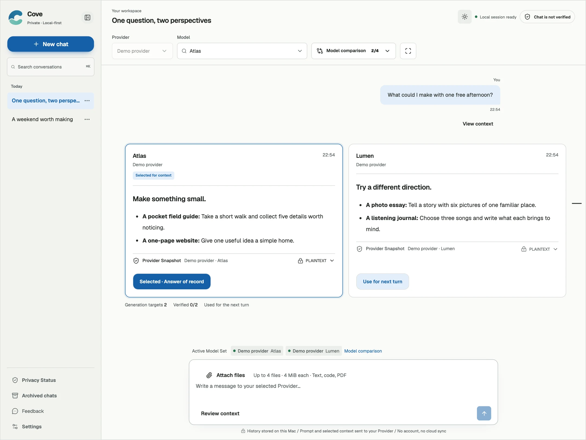

# Cove

A local-first Mac chat app with on-device history and verifiable AI inference.

[](https://github.com/tokenfunplus/cove/actions/workflows/ci.yml)
[](https://scorecard.dev/viewer/?uri=github.com/tokenfunplus/cove)
[](LICENSE)
[](https://discord.gg/7jdddhG8ZG)

Cove keeps conversation history on your Mac and connects to the model providers you choose. A SwiftUI menu-bar Launcher starts a local Go service and opens the Chat Surface in your browser. You can use the Mac app without signing in.

[Quick start](#quick-start) · [Screenshots](#screenshots) · [Configuration](docs/configuration.md) · [FAQ](#faq) · [Development](docs/development.md) · [Dependency patches](docs/dependency-patches.md)

## Quick start

### Install the beta

Requires an Apple Silicon Mac running macOS 13 or later.

> 🎁 **NEAR AI starter key** · [Sign in to Cove Web](https://www.hicove.io/account) to claim an API key with a $1 spending limit. One key per verified account, while supplies last.

1. Download [Cove 0.1.0-beta.8 for Mac](https://github.com/tokenfunplus/cove/releases/download/v0.1.0-beta.8/Cove-0.1.0-beta.8-arm64.dmg).
2. Quit an earlier Cove instance, open the DMG, and drag **Cove.app** to **Applications**.
3. Launch Cove, open **Settings → Provider settings**, enter your Provider key, click **Test connection**, choose a model for your initial Active Model Set, then click **Save Provider**.
4. Confirm the Provider/model target in the workspace, then send your first message. Use **Model comparison** to select up to four targets.

Provider Profiles describe connections; model targets belong to the Active Model Set. Initial setup adds the chosen target only when no targets are selected. Saving Provider edits leaves an existing set unchanged; change its targets through the workspace's model controls.

Check the release page for Apple signing and notarization status. [Release notes and checksums](https://github.com/tokenfunplus/cove/releases/tag/v0.1.0-beta.8) accompany the download. Existing history, file attachments, and settings are retained when upgrading. The interface is English; messages, titles, and prompts support Unicode content.

See the [user guide](docs/user-guide.md) for file chat, Focus mode, and timeline bookmarks, or the [configuration reference](docs/configuration.md) for Provider and generation settings.

### Run from source

For the browser-based Chat Surface, use an Apple Silicon Mac with macOS 13+, Xcode Command Line Tools, Node.js 24.22.1+, pnpm 10.11, Go 1.26+, and `make`.

```sh
git clone https://github.com/tokenfunplus/cove.git
cd cove
pnpm install --frozen-lockfile
make start-local
```

When no Local Service is running, the command builds the web assets and service, then opens an authenticated browser session. It reuses an already-running service without rebuilding. After changing Go or web source, run `make stop-local` before `make start-local` to rebuild. Configure your Provider in Settings as above. Stop the service when your development session ends:

```sh
make stop-local
```

Building the native Launcher requires Swift 5.10+; its XCTest suite requires full Xcode. Web, API contract, and Go checks also run on Linux. See [development](docs/development.md) for platform requirements and validation commands.

## Screenshots



The actual Cove interface with synthetic conversation content and simulated Atlas/Lumen replies. [View Focus and timeline bookmarks](docs/images/focus-mode.webp), explore [more workspace previews](https://tokenfunplus.github.io/cove/#preview), or read the [capture notes](docs/images/README.md).

Additional captures: [Local math rendering](docs/images/chat-math.png) · [Reviewed workbench revisions](docs/images/answer-workbench.png) · [Model filters](docs/images/model-filters.png) · [Response details](docs/images/response-details.png). [Web search settings](docs/images/web-search-settings.png), [the composer toolbar](docs/images/web-search-composer.png), and [mobile dark mode](docs/images/web-search-mobile-dark.png) show the Beta 8 research flow. These use the same isolated synthetic browser fixtures.

## Features

This section describes the current source tree, including unreleased changes. Published downloads follow their [release notes](docs/releases/0.1.0-beta.8.md); see the [unreleased changelog](CHANGELOG.md#unreleased) for newer work.

- Stream responses from OpenAI-compatible providers or the built-in NearAI preset.
- Compare up to four models in one turn; select the answer used in later context.
- Run continuous multi-model Debates with cited stage summaries, explicit pause/step/stop, saved history, and compact Focus reading.
- Track cumulative Debate usage and optional cost estimates, configure budget reminders or automatic pause, and set turn intervals.
- Browse model brand icons, advertised prices, context limits, and capabilities; use favorites, recent models, filters, and saved model combinations.
- Read Provider-declared reasoning separately; it folds when streaming ends and stays out of later selected-answer context.
- Render inline and multiline LaTeX, matrices, and aligned equations locally, with horizontal scrolling for long comparison formulas.
- Select a passage for a separate side conversation, or edit an answer in a workbench with local undo, change review, and Markdown download.
- Edit a saved prompt and resend it in an independent branch using its exact saved context and attachments.
- Open Response details for timings, Provider-reported token usage, the Provider Snapshot, and verification reports; estimate cost using your own model rates.
- Expand the reading area with Focus mode and jump between turns using timeline previews and browser-local bookmarks.
- Pause following by scrolling upward, retain the reading position through layout changes, and return with an updated-answer count.
- Attach text, Markdown, code, and text-based PDF files; preview extracted text, inspect Provider context, and open cited source lines or pages. File chat supports four files per turn, up to 4 MiB each; scanned PDFs need OCR first.
- Read a public webpage from the composer, preview its extracted text, and retain cited source snapshots with their URLs and read time. Files and webpages share the four-source limit.
- Enable per-conversation Web search through Tavily, Linkup, or Exa with per-model request budgets, saved citations and References, and verified NearAI tool requests.
- Inspect the provider, destination, configuration snapshot, and available verification evidence for each response.
- Use NearAI's browser-side encryption and attestation flow for supported private models.
- Search titles and saved message text locally, read matching excerpts, and jump to the relevant turn; pin, archive, and rename conversations.
- Protect unsent text and attachments when navigating, and export comparison choices with saved answers as Markdown or JSON.
- Check for beta updates explicitly from the Launcher without changing the stable update channel.
- Configure a System Prompt, generation parameters, and light or dark appearance.
- Store provider credentials in macOS Keychain by default.

**Local-first describes storage, not model execution.** Prompts and selected conversation context are sent to your provider. Local history is not encrypted by Cove. HTTPS alone does not establish confidential computation, and verification capabilities vary by model. Read the [privacy and trust model](docs/privacy.md) before relying on a verification label.

Choose a workspace skin in **Settings → General → Workspace skin**. Continuum uses warm neutrals and blue, Blueprint uses a compact technical grid, and Studio pairs violet surfaces with serif headings. Grove keeps the original forest palette. Each skin supports the existing Light, Dark, and System modes. Cove remembers your skin in this browser for the Local Service address.

## Configuration

Use the [configuration reference](docs/configuration.md) for Provider fields, generation parameter ranges and defaults, local storage, browser preferences, Local Service options, and development/release environment variables. Everyday Provider settings are managed in **Settings**; credentials use macOS Keychain by default.

## FAQ

- [Which Macs can run Cove?](docs/faq.md#which-macs-can-run-cove)
- [Do I need an account, and where do models run?](docs/faq.md#do-i-need-a-cove-account-and-where-do-models-run)
- [Where are chats, keys, and bookmarks stored?](docs/faq.md#where-are-chats-keys-and-bookmarks-stored)
- [Why does macOS ask for Keychain access?](docs/faq.md#why-does-macos-ask-for-keychain-access)
- [What if the Local Service is unavailable or the interface looks stale?](docs/faq.md#what-if-the-local-service-is-unavailable-or-the-interface-looks-stale)
- [Why are models unavailable after granting Keychain access?](docs/faq.md#why-are-models-unavailable-after-granting-keychain-access)
- [Which files can I attach?](docs/faq.md#which-files-can-i-attach)
- [How do I update a beta?](docs/faq.md#how-do-i-update-a-beta)

Browse the [full FAQ](docs/faq.md) for language and support questions. For build/toolchain problems, see [development troubleshooting](docs/development.md#troubleshooting). Report reproducible issues through [GitHub Issues](https://github.com/tokenfunplus/cove/issues), removing keys, launch URLs, and private content from diagnostics.

## Build a Mac app

```sh
make dmg
```

The build produces `.artifacts/Cove.app`, `Cove-0.1.0-beta.8-arm64.dmg`, and a SHA-256 checksum. App packages are ad-hoc signed unless `COVE_SIGNING_IDENTITY` is configured. Developer ID signing and notarization require your own Apple credentials; see [releasing](docs/releasing.md), including how to sign a CI-built app without full Xcode locally.

## Community

Join the [Cove Discord community](https://discord.gg/7jdddhG8ZG) for setup help, provider discussions, feedback, and contributor coordination. Start in `#welcome` and read `#rules`; use `#support` for troubleshooting, `#ideas` for feature discussions, and `#development` to coordinate contributions. Release news appears in `#announcements`.

Keep reproducible bug reports and actionable work in [GitHub issues](https://github.com/tokenfunplus/cove/issues) and [pull requests](https://github.com/tokenfunplus/cove/pulls). Report vulnerabilities privately through [SECURITY.md](SECURITY.md). Never post Provider Keys, launch tokens, or private conversation data.

## Develop and contribute

```sh
make check  # repository conventions, TypeScript, Go formatting, and go vet
make test   # API contract, web, Go race tests, and Swift tests
```

See [CONTRIBUTING.md](CONTRIBUTING.md) for the contribution workflow and [SECURITY.md](SECURITY.md) for private vulnerability reporting.

| Resource | Purpose |
| --- | --- |
| [User guide](docs/user-guide.md) | Installation, Providers, file chat, comparisons, and updates |
| [Configuration](docs/configuration.md) | Fields, defaults, limits, storage, and environment variables |
| [FAQ](docs/faq.md) | Common questions and recovery steps |
| [Development](docs/development.md) | Commands, prerequisites, and troubleshooting |
| [Architecture](docs/architecture.md) | Components, data flow, and invariants |
| [Privacy](docs/privacy.md) | Network destinations, credentials, and verification limits |
| [Releasing](docs/releasing.md) | Packaging, signing, updates, and GitHub releases |
| [Domain glossary](CONTEXT.md) | Shared terminology |
| [Architecture decisions](docs/adr/) | Design rationale and superseded decisions |
| [Changelog](CHANGELOG.md) | Release history |

## License

[MIT](LICENSE). Third-party dependencies retain their own licenses; see [THIRD_PARTY_NOTICES.md](THIRD_PARTY_NOTICES.md).

## Web search

Enable the globe icon in a conversation to let compatible models search when needed. Configure Tavily, Linkup, or Exa in Settings → Web search. Each model attempt has its own request limits and saved source evidence. Search queries leave the model transport and go to the selected search service. Continuous Debate does not inherit this toggle. See [the user guide](docs/user-guide.md) for limits and citations.
