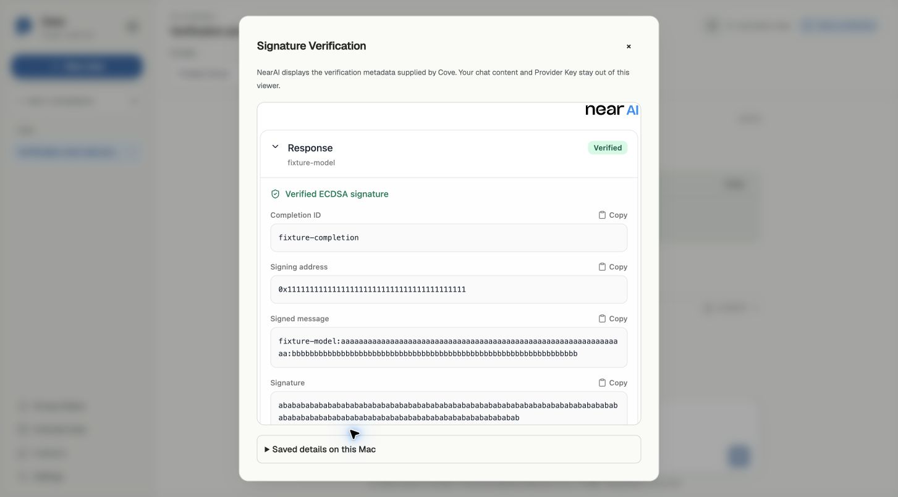
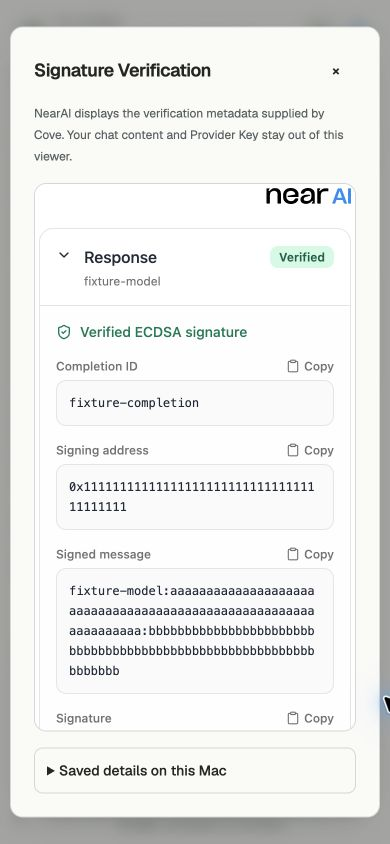
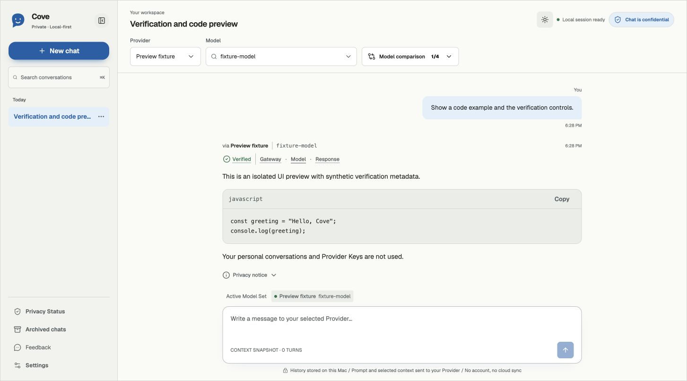

# Embed NearAI verification reports with a local fallback

Verification dialogs embed the NearAI Cloud verification center at the fixed `https://cloud-stg.near.ai/verify` origin, matching Cove's staging preset and the shared iframe protocol used by LibreChat. The browser remains responsible for cryptographic verification. The iframe displays selected saved results; opening it does not repeat verification or change persisted Generation state.

The adapter projects model and gateway attestation metadata, runtime measurement hashes, signer identities, and response receipts into version 1 reports. It excludes Provider Keys, prompts, conversation content, raw quotes, arbitrary signed text, and deployment configuration. Response signed text must contain only the model identifier (for model receipts) and two SHA-256 hashes, with a signer matching the attestation. Missing historical fields produce an unverifiable report or a local-only fallback, never invented verification timestamps or provenance verdicts. Gateway reports remain partial in the protocol.

The host installs its message listener before navigation, checks the exact source window, origin, protocol version, and request identity, and sends reports only to the fixed origin. Reports are bounded to 1 MiB and 1,000 entries. Timeout and protocol failure disconnect the frame and expose a reload action. Closing, unmounting, or changing the theme cleans up the connection. The frame has no referrer, uses a scripts/same-origin sandbox, and receives only clipboard-write permission. The Local Service CSP permits frames only from that origin while retaining `frame-ancestors 'none'`.

Message status labels with saved evidence are direct, keyboard-accessible shortcuts to model, gateway, and response details. Gateway shortcuts initially display only the gateway report; switching local tabs retains both records. Unavailable re-verification actions are hidden, and clipboard failures receive explicit feedback.

Local saved details remain accessible when the network or viewer is unavailable. Cove's existing explicit Verify Again action remains responsible for re-verification; the embedded static report does not request new inference. The viewer is remote code with access to the projected report, and its availability and rendering can change independently of Cove. This adds a disclosed presentation destination to the privacy model; it does not move inference or persistence ownership described in ADR-0012 and ADR-0019.

## Presentation evidence

These screenshots use synthetic saved metadata in an isolated test database. They demonstrate iframe rendering, not cryptographic validation of a live completion.

