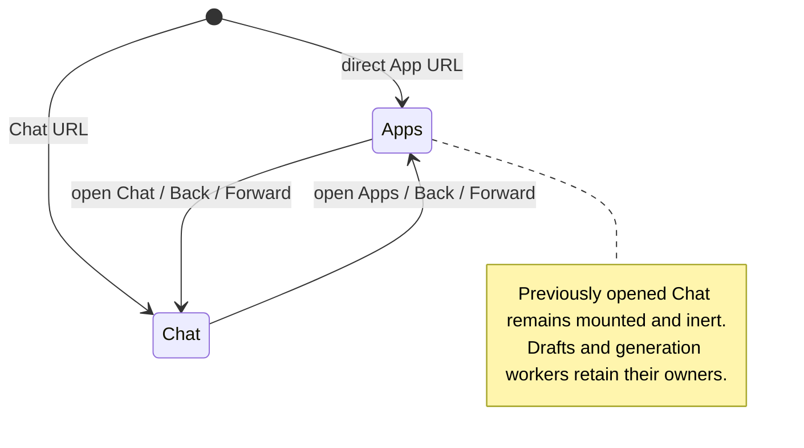

# Host declarative Mini Apps on the Mac

Date: 2026-11-27

Cove accepts versioned, data-only JSON packages that declare typed collections,
bounded named operations, and pages containing those operations. The browser
renders trusted controls. The Go host resolves package expressions and derives
the effects of each operation. A package author can define application rules
using these primitives and test them against the production interpreter in an
ephemeral workspace. The first contract supports Japanese Review Book and
Reading Inbox. Extending this grammar requires versioned compatibility and
conformance fixtures for both apps.

A release identifies immutable package bytes within an origin, publisher, app
and version. An instance owns the active release reference, records, grants and
local identity. Each instance upgrades independently. Authoring, viewing and
installing packages are separate from allowing an instance to access a Mac
selection or send user input to a model. A deep link conveys navigation intent.
The authenticated Local Service resolves the target and enforces grants.

The bundle and the configured signed catalog share a release authority.
When restoring a personal instance backup, either channel can supply the
exact official package recorded in the backup. Restoration verifies its
publisher, app, version and SHA-256 digest. A locally imported release
retains its separate identity.

This extends the existing boundaries in [ADR 0012](0012-make-chat-the-local-service-application-facade.md)
and [ADR 0063](0063-add-json-interactive-chat-cards.md). Chat owns model
execution and access to Provider credentials. A Mini App owns the requests it
initiates and their results. Chat owns snapshots explicitly brought into a
conversation. Removing that conversation preserves the originating App instance.
The existing commitments for [local model policy](0053-integrate-local-capabilities-into-chat-and-projects.md)
and [native selection](0061-import-macos-content-into-quick-panel-drafts.md)
also apply when requests originate in a Mini App.

The public [authoring contract](../mini-apps.md) describes the release format,
author tools and executable example scenarios.

## Public discovery and local installation

CoveWeb owns the public app list, package details, public examples, version
browsing and downloads. The combined design demo does not define an embedded
marketplace in Cove. Local Cove manages installed instances, file import,
installation review, permissions, execution, backups and data-preserving updates.
An external website link replaces its earlier local Discover surface; legacy
catalog bookmarks open My apps. This supersedes the earlier workspace layout.

Public **Open in Cove** links carry a package identity and exact version. The
Launcher and authenticated local installer decide whether to open a copy, offer
a chooser or review installation. Public pages do not query local inventory or
guess which release is installed. The signed catalog client remains part of
local installation verification and update checks, independently of website
presentation. This correction changes no data schema, release authority or
instance ownership.

Visual Studio Code registers commands and views through JSON declarations in
its extension manifest. This provided a reference for referencing one named
operation from several host surfaces. Cove's interpreter implements the
package operations and applies instance grants. See the
[VS Code contribution points](https://code.visualstudio.com/api/references/contribution-points).

SQLite schema 32 adds Mini App releases, instances, typed records, attachment
blobs, write receipts, model tasks, activity, cloud policy and conversation action
scope in one additive migration from schema 29.
Existing Conversations, Projects, interactive cards and Provider Profiles
retain their owners. Older services reject schema 32. Package schema versions
advance independently inside individual instances. The first package format
supports additive migrations with defaults; an incompatible migration rolls
back its record changes and keeps the previous release active.

The NearAI browser remains responsible for SDK verification when a Mini App
starts a generate task. A single claim belongs to the initiating Browser
Session. Settlement validates the receipt for the frozen target's privacy
mode and saves it with the instance-owned task. Loss of the browser expires
the task without exposing partial output. Both verified and ordinary model
tasks use Chat's shared active-work admission.

## Runtime 1.1

The user can scope a normal conversation turn to named actions of one instance. The Generation configuration stores the authorized release and revision. The host checks them again before invoking the proposed action. Query results remain local until selected. Writes use a separate reviewed confirmation. An app-owned model task can start after the conversation releases its execution slot.

Cove distinguishes runtime version, immutable package release, collection schema version and record revision. A downloaded file can reuse a trusted release when its exact digest matches the verified source. The signed catalog format adds expiry and a persistent per-key sequence checkpoint. Installed releases remain available when remote verification fails. Finder-launched sessions can use packaged public trust settings or explicitly configured local preferences.

## Review follow-up

Verified Mini App settlements store a receipt in the task's existing request
metadata. The receipt binds the exact response, browser session and claim.
Delivery retries are idempotent after acceptance and do not repeat inference.
This adds no host database migration. Record editors bind their target selection
when opened, while cross-workspace navigation retains the Chat workspace.

## Directory authority and cloud policy

Only a catalog verified by the public key embedded in the Cove release can
supply updates for bundled publisher identities. A user-selected signing key
has an independent authority. Changing it requires explicit confirmation bound
to the previously displayed URL and key, and each key retains its own rollback
checkpoint. Official key rotation therefore requires a Cove release carrying
the new default key followed by confirmation for a saved directory configuration.
This supersedes the initial shared-authority statement above.

SQLite schema 32 adds a per-instance cloud permission with a default of false.
Existing records, attachments and local generation grants retain their values.
The setting controls app-owned remote tasks independently of local generation.
Query invocations no longer write activity rows, preserving room for reviewed
writes and model-task lifecycle entries. The workspace can inspect activity and
remove only package releases that have no instance references.

Model-task admission, terminal state, browser settlement receipts and activity
changes commit in one persistence transaction. Activity failure cannot leave a
running task without its worker or acknowledge only part of a verified result.
Restart recovery updates task and activity states together.

## Directory preference modes and scoped histories

An unset directory override follows the public URL and key packaged with the
installed Cove version. Saving those exact configured defaults preserves that
mode. A custom directory remains pinned across Cove updates; an explicitly empty
selection stays bundled-only. The backend retains these modes for development; v1 shows read-only source
information, hides custom directory editing and uses packaged defaults, with
environment overrides for testing.

Release-version and publisher histories are scoped to the signing key, just like
rollback checkpoints. Switching authorities cannot transfer a conflicting version
history to another signer. Returning to an authority still enforces its prior
sequence and immutable releases.

Conversation interception requires an available app and explicit `@Name` for a
named app. Installed-app discovery shortcuts stay local and preserve an existing draft.
Candidate validation reports individual invalid rows so valid selections remain
usable; committed batches retain their all-or-nothing validation. Debate retries
transient delivery of a frozen verified result without claiming or charging a
second inference, and never replaces it with an empty failure receipt.

## Author drafts and task settlement recovery

Structural draft validation is separate from installation authority. The editor
may validate an unpublished package from a known publisher, but receives no
release identity or verified-origin attestation and cannot access live records.
Public package previews are validated before their original bytes are returned.

Chat retries a frozen App task settlement without repeating inference. If storage
remains unavailable, one pending settlement stays in service memory and blocks
additional App model work while ordinary Chat continues. An authenticated owner
can retry persistence without receiving data or restoring execution grants; an
explicit instance deletion removes that instance's pending settlement. Accepted
verified browser receipts remain idempotent. Restart cannot recover an unsaved
in-memory output and never automatically repeats the paid request.

## Explicit unsaved-result recovery

An owner may confirm discarding one unsaved model output. Chat first stores a
cancelled terminal state with no output, then releases admission for other App
tasks. If cancellation cannot be stored, the original output remains recoverable.
An already committed answer is never replaced by a late discard. Recovery remains
available after generation permission is revoked and does not remove records,
attachments, or the instance. Activity names the blocking app and offers a direct,
draft-protected navigation path from Chat.

## Per-release catalog signer continuity

A verified catalog release now persists the SHA-256 fingerprint of its Ed25519
public key as part of its immutable release identity and storage provenance.
Public responses retain the `catalog` channel and separately expose the signing
authority and whether it matches the packaged Cove default key. Catalog updates
must retain that fingerprint, even after a confirmed directory-authority switch.
Only the packaged official authority can succeed a bundled identity. This
supersedes the earlier policy that a newly selected catalog authority could
update every non-bundled publisher identity.

Directory failures cache only empty fallback metadata and the original warning
for five seconds when no valid verified index remains. A forced refresh for a
downloaded file preserves a still-valid verified index for ordinary catalog reads;
its failure has a separate five-second backoff for file checks and cannot attest
to an unknown release. Cancelled requests do not populate either failure cache,
and any trust or URL change invalidates them.

## Workspace navigation and retained Chat state

Switching between Chat and Mini Apps uses ordinary same-origin history entries.
Chat mounts on its first visit and stays mounted while Mini Apps is visible.
Drafts, attachments, interactive cards, answer tools and generation workers remain
owned by that Chat workspace. Entering Apps does not discard or cancel them, so
Back and Forward need no interception, corrective traversal or inferred history
positions. A direct App URL does not bootstrap Chat until its first visit.

The inactive Chat surface is invisible and inert while keeping its layout. Its
search and focus-mode shortcuts and Launcher intents are suspended. Dialogs and
portaled controls cannot capture input above the active App surface. Private
inference and Debate workers continue with their existing ownership and limits.
Refreshing or leaving the document still uses the existing unsaved-draft warning.

App snapshot handoffs retain their existing new-conversation behavior and Chat's
conversation-switch confirmation. An asynchronous handoff cannot replace a newer
workspace destination. App scroll restoration stores at most 128 offsets by local
URL for the life of the document; revisiting the same URL shares its last offset.
It does not store navigation metadata or user content in browser history.

The first Mini App database migration is schema 29 to 32. Existing schema-32
development databases keep their final structure and contents. Unreleased schemas
30 and 31 are rejected without migration; export their data using the matching
development build before resetting an obsolete development database. No automatic
reset deletes data. Pre-release preference/key aliases and local-to-official
package promotions are unsupported. Local packages retain local update lineage.

## Review-bound installation and deterministic package upgrades

Installation binds the exact reviewed bytes and release authority. Catalog
confirmation includes the reviewed signing fingerprint, and file confirmation
includes the previewed release identity and digest. Concurrent trust changes
require a new preview instead of installing under a different authority.

Skipped additive migration steps materialize the first default for each new
field, matching sequential upgrades. Later additive defaults do not overwrite
that stored value. Record size and instance quota checks run before migrated
record writes, within the existing atomic upgrade transaction. Date defaults
use civil calendar arithmetic, so DST changes cannot shift a reviewed date.

## Independent application sources and releases

CoveWeb owns business-app source packages, fresh-instance scenarios, migrations
and upgrade scenarios. Its publication command runs the public coveapp validator,
scenarios, upgrade checks and packer before exposing immutable downloads or
signing an index. An app can publish a new version without rebuilding Cove.
The Mac runtime embeds no business app package. Its author kit ships a minimal
generic notes example instead of Japanese Review Book or Reading Inbox.

Five old release identities and exact SHA-256 digests remain as read-only
compatibility metadata. They authenticate only those historical downloaded bytes,
not new versions or modified packages. Installed releases already live in local
storage and are neither removed nor rewritten. Official successors still require
the configured official signing key; other signers cannot inherit those instances.
The database schema and existing instance IDs, records, attachments and grants
are unchanged. An unavailable remote source has no installable fallback packages.

Historical package bytes remain frozen under testdata for host regressions only.
New app business-rule changes and canonical source edits belong to CoveWeb.
Author CLI previews use local provenance inside their disposable stores, without
claiming publisher authority; the production HTTP installer remains the authority
boundary. This supersedes package embedding and embedded-example attestation
for author commands in the earlier sections.
