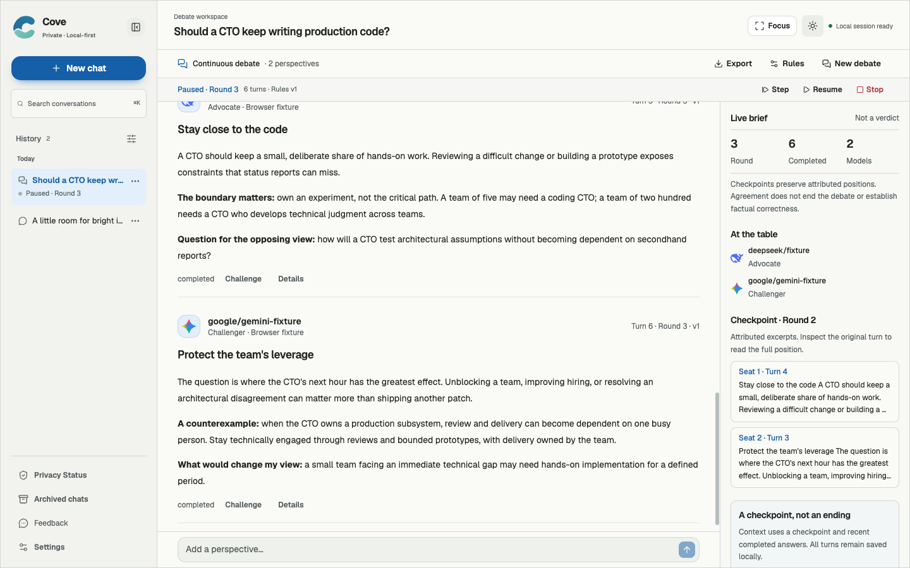
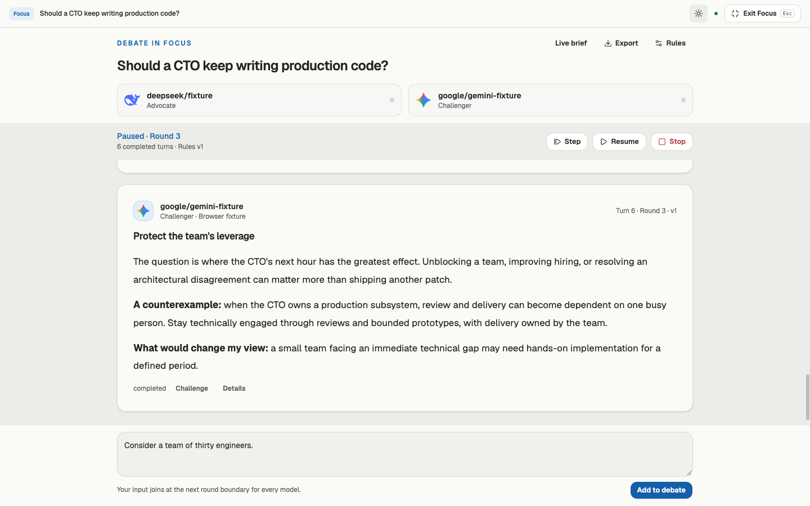
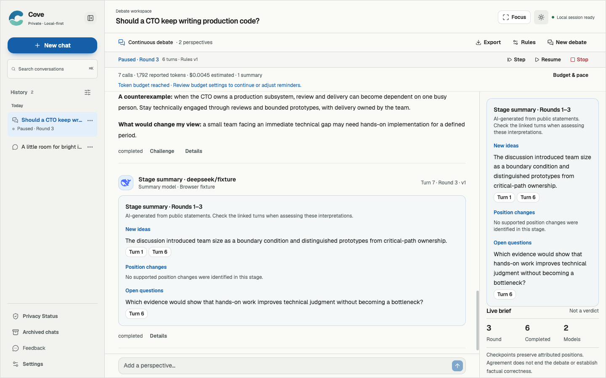
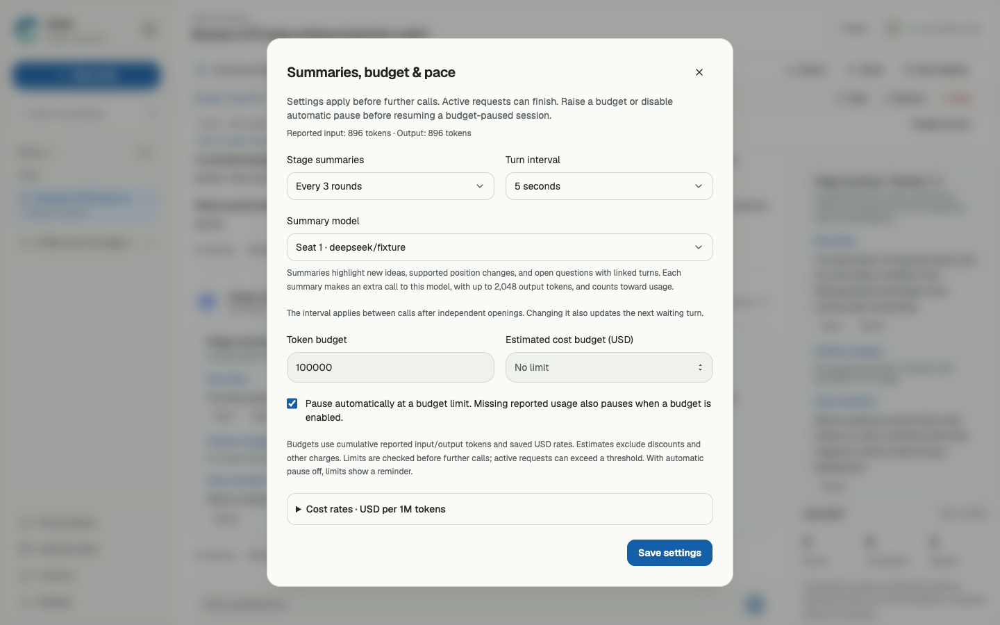

# Continuous Debate mode

Choose **New debate** in the workspace toolbar. Enter a topic, choose two to four distinct model targets from configured Providers, assign a role to each seat, and define the ground rules. Models may share one Provider, including NearAI. Model identity and analytical role are independent settings. NearAI uses the same browser encryption and verification transport as ordinary Chat.

**Start debate** opens a locally saved conversation. Models give independent opening answers, then take rotating turns to challenge claims, inspect evidence, and explore new angles. There is no round limit or automatic stop when models agree. Service-driven calls continue while the Local Service runs, including when the browser is closed. For debates with NearAI seats, keep the debate open for encryption and verification. Calls use your configured Provider Keys and Provider allowance.

## Workspace

The topic appears once in the workspace header. A compact toolbar groups **Export**, **Rules**, and **New debate**, with the current round, completed-turn count, and run controls directly below. The live brief keeps participants and short attributed excerpts alongside the transcript. Expand the NearAI connection notice for its browser-lifecycle details; failed turns and verification results remain visible.

The intervention field starts on one line and grows with the draft. Use its up-arrow **Add to debate** button or Command/Ctrl+Enter to submit; Enter adds a line. Hover over the field for the round-boundary explanation.

## Controls

- **Focus mode** in the workspace header hides conversation navigation and the persistent live brief, gives the transcript the main visual space, and shows participants with their speaking status. Pause, Resume, Step, Stop, rules, and interventions stay available. Open **Live brief** for attributed positions. **Exit Focus** or Escape restores the workspace; a dialog receives Escape first. Switching views preserves the intervention draft, current inference, and reading position when following is paused. Focus is window-local presentation state.
- **Pause** finishes active work and prevents another turn. During the blind opening, all already-active opening requests may finish.
- **Step** runs one turn while paused; an incomplete opening advances its outstanding independent seats as a group.
- **Resume** continues a paused session. A Provider failure pauses automatically; check the connection before resuming the unfinished seat.
- **Stop** cancels active requests and ends the session permanently. Completed turns remain saved; incomplete text is discarded. Start a new debate for another session.
- **Add to debate** queues a question or perspective for every model at the next round boundary. Up to eight interventions can wait. Rules edited through **Rules** also apply at the next boundary. Existing turns retain their original version. Changing the topic or model seats requires a new session.

The live brief shows participants and attributed excerpts from completed turns. Checkpoints do not declare a winner or establish factual correctness. Use turn details to inspect the Provider Snapshot, observed usage, effective rules, and context source identifiers. Missing usage and prices stay unavailable.

## Stage summaries

New debates default to a stage summary every three completed rounds. In setup or **Budget & pace**, choose **Stage summaries** to turn it off or select a cadence of one to ten rounds, then choose an existing seat as the **Summary model**. Older sessions start with summaries off until you enable them. Each summary makes an additional model call with up to 2,048 output tokens and counts toward usage and budgets.

Summaries collect **New ideas**, **Position changes**, and **Open questions**. They appear in the transcript and the live brief, including Focus mode. Select a source **Turn** to inspect the original statement. A summary is a model interpretation of those statements; the linked turns let you assess it. Summary details preserve the original response and any verification evidence.

Summaries cover the configured stage, with an earlier round available for comparison. They use completed public statements, excluding reasoning and failed verification. Generated interpretations do not become participant evidence in later model context. The original excerpt checkpoints remain separate reading aids.

A summary that fails verification or returns invalid citations pauses the debate. Resume continues the discussion after a settled failed summary; no paid summary is retried automatically. Stop remains permanent. Opening an old summary or changing settings does not start a model call.

## Budget and pace

The usage strip shows cumulative calls, reported input/output tokens, summary calls, and an estimated USD cost when rates are available. It includes earlier transcript pages and reported usage from failed/stopped attempts. Missing counts and prices are shown as unavailable or partial. **Budget & pace** exposes the input/output breakdown and editable settings.

- **Token budget** applies to the sum of reported input and output tokens. **Estimated cost budget (USD)** uses the rates saved for every model seat. Both are optional and produce reminders with automatic pause off.
- **Pause automatically** prevents further calls when a configured budget is reached. It also pauses if missing reported usage prevents a complete assessment. Active requests can finish and exceed a threshold, especially during concurrent openings. These controls are not a Provider billing cap.
- Increase the limit or turn off automatic pause before Resume or Step. Changing a limit does not erase prior usage. A new debate starts a separate cumulative account.
- **Cost rates** are USD per million input/output tokens. Setup can suggest your existing browser preferences or Provider-advertised rates. Saving them stores a copy with this debate; editing them recomputes the cumulative estimate. Estimates exclude discounts and other Provider charges.
- **Turn interval** controls the wait after completed work, from no delay to sixty seconds. Independent opening requests still start together. Changes update a waiting turn immediately; Resume and Step start without the old wait.

Settings apply before further calls, while active requests may finish. Concurrent edits from another tab are rejected; reopen the settings to load the latest version. Settings remain readable after Stop. Ground-rule edits still apply at a round boundary.

Older turns are paginated. **Export** includes all settled turns and the most recent sixty-four interventions. Ordinary conversation and workspace downloads also include debate transcripts. Provider reasoning is separate from public answers and never enters later debate context.

History search currently finds debate conversations by title. Debate turn bodies are read through the paginated transcript rather than the ordinary message search index.

Closing the Chat Surface does not stop a debate containing only service-driven models. Leaving a debate with active NearAI work interrupts that browser request and pauses the session. An unavailable browser also times out and pauses automatically; **Resume** retries only unfinished seats. A reload or second tab cannot repeat an already claimed request. Quitting/restarting the Local Service pauses every debate and requires explicit Resume. Only one ordinary Generation Batch or Debate Session can run at once. Pause releases that reservation. Deleting a debate or clearing history cancels its requests before removing local records.

NearAI turns show environment/response verification phases and the saved verification result. **Details** exposes the original receipt and evidence. Failed verification never contributes an answer to later debate context, including gateway modes. The transcript retains verification summaries; large evidence records are fetched only for turn details.

## Compatibility and scope

This feature now migrates local storage to schema 21 so older services cannot ignore persisted budget and summary controls. Older versions reject that schema; preserve a compatible backup if you need to downgrade. See [the original architecture decision](adr/0037-add-service-owned-continuous-debate-sessions.md) and [stage summaries and run controls](adr/0041-add-debate-stage-summaries-and-run-controls.md).

The current implementation has no browsing tools, winner-selection judge, or argument map. The live brief contains attributed checkpoints and explicitly generated, cited stage summaries. Checkpoints make no extra model calls; stage summaries do. Per-turn output, duration, and context stay bounded even though a session has no round limit.

## API

All routes require the local Browser Session. Mutations also require the existing origin/CSRF proof.

| Method | Route | Purpose |
| --- | --- | --- |
| POST | `/api/debates` | Idempotent creation with `client_request_id`, topic, seats, and rules |
| GET | `/api/debates/{id}?before={sequence}` | Session state, up to fifty turns, recent interventions |
| GET | `/api/debates/{id}/turns/{turn}` | Inspect one original turn |
| POST | `/api/debates/{id}/turns/{turn}/browser/claim` | Claim one scheduled NearAI request and read its immutable messages |
| POST | `/api/debates/{id}/turns/{turn}/browser/progress` | Report transient text and verification phase for the claimed turn |
| POST | `/api/debates/{id}/turns/{turn}/browser/settle` | Settle a claimed turn with the browser verification result |
| GET | `/api/debates/{id}/events` | Coalesced invalidations; reconnect always reconciles reads |
| POST | `/api/debates/{id}/control` | `pause`, `resume`, `step`, or `stop` |
| PATCH | `/api/debates/{id}/rules` | Queue the next effective rule version |
| PATCH | `/api/debates/{id}/controls` | Versioned summary, budget, rate, and pacing settings |
| POST | `/api/debates/{id}/interventions` | Idempotently queue a user intervention |

The read response includes transient current-turn text while active; only complete answers are saved. Effective rules and exact request messages are saved with each turn. Full request contexts are not repeated in workspace read responses.
