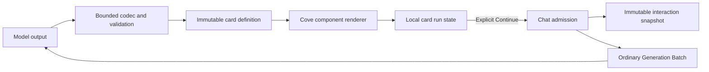

# Cove interactive chat design

Status: Design roadmap, updated 2026-11-25. [ADR 0066](adr/0066-normalize-model-ui-and-bound-chat-overhead.md) supersedes model-facing strict JSON, mandatory Continue, full card history replay, and default-on composer references. New model output uses nested cove_ui input; the strict examples below describe canonical storage. [ADR 0063](adr/0063-add-json-interactive-chat-cards.md) records the implemented initial subset. [ADR 0064](adr/0064-extend-interactive-cards-with-local-editing.md) adds Ranking, integer Slider, AllocationSummary, TextInput, and TextPreview in the immutable v2 contract, with v1 compatibility. [ADR 0065](adr/0065-include-visible-card-context-in-chat-followups.md) implements a visible, removable composer reference for ordinary follow-ups. Sections describing matching, spatial exploration, and structured alternative-choice branches remain proposals.

## Purpose

Make conversations more enjoyable by letting people choose, reveal, experiment, and shape the next response directly inside an assistant message. A useful first interaction should take one or two clicks. The experience should feel like a conversation with something to explore, with ordinary typing always available.

The initial product is an interactive card embedded in Chat. A larger canvas is an expanded view of the same card and state. Form rendering is one building block. The first release focuses on choices, playful learning, and collaborative stories rather than business workflows or a general application builder.

The model composes interfaces from components Cove owns. Cove owns rendering, local state, persistence, and the transition back into a normal Generation. The model receives a deliberate snapshot when the user continues; it does not continuously observe the screen.

## First experiences

| Experience | User request | Immediate interaction | Reason for another model turn | Delivery |
| --- | --- | --- | --- | --- |
| Choice cards and comparisons | Help me choose something to do this weekend | Compare descriptions, select a favorite, reveal tradeoffs | Develop the selected idea | A |
| Quick quiz | Help me learn a little astronomy | Pick an answer, check it, and reveal an explanation | Ask for another question or explanation | A |
| Branching story | Let us play a detective story | Inspect hints, choose an action, or stage a custom question | Generate the consequences and the next scene | A |
| Flip and recall | Help me remember a few new words | Reveal a card's reverse side, then mark Remembered or Practice again | Adapt the next item to the self-rating | A |
| Creative remix | Help me invent a fantasy character | Combine role, temperament, and setting; see the selected ingredient chips | Create a character or story from that combination | A |
| Priority ranking | Help me figure out what matters in my next job | Drag priorities into order, or use Move up/down controls | Explain tradeoffs using the submitted ranking | B |
| Parameter playground | Help me balance a weekend budget | Adjust sliders and see a registered budget split update locally | Propose a plan using the final allocation | B |
| Matching puzzle | Help me learn these concepts | Pair terms and explanations; check pairs and retry locally | Explain confusing pairs or generate the next puzzle | B |
| Collaborative revision | Help me improve this invitation | Edit a short text, switch between supplied variants, preview and undo edits | Rewrite from the submitted working text and explicit instruction | B |
| Clue exploration | Let me investigate a mystery scene | Open labelled clue hotspots, collect evidence, and choose a hypothesis | Judge the hypothesis in the story and reveal the next scene | C |

Delivery A is the first release, using the initial catalog and state contract. Its evaluation examples feature choice, quiz, and story; recall and remix reuse those primitives as additional scenarios. Delivery B introduces richer interaction components; its initial implemented subset is sorting, integer sliders with linked allocation totals, and text editing with a plain-text preview and bounded undo/redo. Delivery C explores a richer spatial surface. These are planned experiences, not claims of currently available features.

The scenarios are examples for evaluating natural model responses. The model supplies content and composition from the current conversation; users do not need to choose a named template. Interface copy is English; generated content follows the user's language.

### Interaction vocabulary

Make the local response meaningful before asking for another model turn. The catalog grows across these gestures:

| Gesture | Immediate result | State to save or submit |
| --- | --- | --- |
| Select and combine | Selected state, comparison details, ingredient chips | Stable selected option values |
| Reveal or flip | A hint, explanation, or reverse side appears | Reveal is presentation-only; explicit self-rating is a saved Choice value |
| Check and retry locally | Correct/incorrect feedback and another attempt | Current answer and applicable checked result |
| Reorder | A visible priority list changes order | Ordered item values; order is semantically meaningful |
| Adjust | Numeric values, allocation totals, or a bounded preview update | Final parameter values and registered calculation version |
| Pair | A connection is created or removed and can be checked | Stable item pairs and applicable checked result |
| Edit and undo | A short working text changes with a bounded undo stack | Current text; undo history remains window-local |
| Explore | A clue opens and can be explicitly collected | Collected clue values and chosen hypothesis; no pointer or hover trace |

All local gestures make zero Provider calls. They can be repeated before Continue consumes the run. Model reasoning or newly authored content arrives only after Continue or Ask about this. Do not add a model request to every slider movement, drag event, card flip, or edit.

### Three richer walkthroughs

**Recall card, Delivery A.** The model presents one word and a short question. The user tries to recall it, activates Show answer, and reads the reverse side through Reveal. They mark Remembered or Practice again with Choice, then click Next card. Cove submits the self-rating; the model generates the next item. Showing the reverse side alone does not claim a correct answer or record a learning score.

**Character remix, Delivery A.** The model offers small option sets for role, temperament, and setting in one card. Each selection updates visible chips locally. The user can revise the ingredients before clicking Create character. The preview shows selected ingredients; a newly written character description requires that explicit model turn. Asking to change the result produces another ordinary message or a new card rather than rewriting the original.

**Budget playground, Delivery B.** A fixed total is distributed across a few categories. Sliders update amounts and a remaining-budget indicator immediately; the user can restore initial allocations before continuing. A typed, versioned host calculator computes the sum and remaining amount. It does not invent local recommendations or execute formulas supplied by the model. Suggest a plan sends the final allocation to the current model, which produces a new answer.

Keep each card focused on one task. A rich card can offer several local gestures but still has one primary continuation action. Avoid requiring a dashboard, a long setup wizard, or learning a new interaction language before the conversation becomes useful.

An illustrative story turn:

```text
Assistant                                      Provider Snapshot

The lighthouse is dark, but someone is moving upstairs.

+------------------------------------------------------+
| What do you do?                                      |
|                                                      |
| ( ) Follow the footprints                            |
|     They lead toward the cellar.                     |
| ( ) Knock on the upstairs door                       |
|     The light disappears as you approach.            |
| ( ) Examine the abandoned radio                      |
|     It is still warm.                                |
|                                                      |
| [Continue story]                                     |
+------------------------------------------------------+

You can also type your own action below.
```

The next scene is a new assistant message. Previous scenes and submitted choices remain readable in the timeline.

## Product behavior

### Discovering the feature

Single-target Chat makes interactive cards available automatically. There is no composer mode switch, scenario menu, or template prerequisite. The model receives a compact component guide and chooses a card only when it helps with the actual conversation. Ordinary greetings, facts, calculations, and explanations remain direct text answers.

For example, a discussion about a tiring week can naturally lead to a small set of tailored weekend choices. A request to practice vocabulary may lead to a recall card. A text answer can follow a card, and users can always continue by typing. Do not force a clarification form or an extra click when the model already has enough information to answer.

The experience list is a design and evaluation corpus, not a required user-facing menu. Multi-target Chat and Debate retain ordinary behavior in the initial version. Capture the optional-card capability per admitted Batch so retries and both inference paths see the same component instructions; this internal policy is not a user-selected conversation mode.

### Inside a message

A message contains readable prose and at most one interactive card. The card follows Cove's existing typography, semantic colors, spacing, focus states, and skin. Its title is the user's task or story question, rather than a technical feature label. Details are initially compact and can be revealed locally.

Options use visible selected states; feedback uses text as well as color. A card has at most one primary continuation button. Selecting an option never sends a message by itself. Labels such as Continue story and Explain my answer describe the next action. Avoid generic Submit labels where a conversational label is clearer.

Typing remains independent. A typed follow-up does not silently include unsent card selections. A host-provided Ask about this action stages one visible card-reference chip in the composer, allowing a custom question with the card's values. The chip previews the submitted fields and can be removed. Its submission follows the same eligibility, snapshot, and single-submission rules as Continue. Card Continue leaves unrelated composer text and pending attachments intact and does not silently send them.

The continuation footer shows the current selected model and execution destination. A card does not silently reselect the model that originally generated it. Submission uses exactly one current target, expected-target checks, and the existing local-only and Private TEE admission rules. A changed or unavailable target produces the existing actionable admission error without consuming the card.

### Local actions and model continuations

Local actions select a choice, reveal a detail, check a quiz answer, or reset an unsubmitted card. They update the UI immediately and make no Provider request. A short, subtle transition can acknowledge the interaction; respect reduced motion.

A continuation action validates required choices and shows a concise summary beside its button, such as Selected: Examine the radio. Clicking it creates a visible user turn and one ordinary Generation Batch. There is no extra confirmation dialog. While admission is pending, disable duplicate submission and preserve the exact submitted values.

Once admitted, the old card becomes a read-only record of that interaction. Display the selected answer and link to the resulting turn. Try another choice opens a separate branch draft seeded from that snapshot, then extends Cove's existing edit-and-resend command to submit an alternative structured interaction. Do not change an earlier submitted choice underneath later story turns. Plain text editing of the generated user turn creates an ordinary text branch and drops that turn's structured interaction attachment; it cannot silently retain values that contradict the edited text.

Quiz checking is local: Check answer reveals model-authored feedback. Continue asks the model for the next question. The answer key is present locally and is not suitable for secure assessment. A model-generated explanation is ordinary assistant content and may be wrong; users can discuss it in Chat.

### Expanded canvas and Quick Panel

Provide Expand for cards whose content benefits from more room. The browser workspace uses a side panel on wide screens and a dialog on narrow screens. Inline and expanded views share one state owner; opening or closing the expanded view cannot reset values or submit an action.

Quick Panel supports the same compact cards in a single column. Long content stays within the panel's existing bounds. Open in Cove uses the existing authenticated Conversation handoff and restores the same saved state. The initial release does not add a freeform canvas, draggable windows, or multiple independent agents.

Before handoff, flush run saves and confirm the acknowledged revision. If saving fails, keep the panel and draft available and show recovery. The receiving surface reads service-owned state rather than trusting another window's memory. Browser windows independently cache the same run; revision checks reconcile them. Expanded views inside one window share the controller, while each mounted view has a separate DOM-ID namespace for accessible labels and controls.

### Which cards may continue a conversation

A new continuation must reference the exact Selected Answer of the latest Batch at the Conversation tail, with no later admitted user turn. Its source attempt must satisfy Cove's existing answer-selectability rules, including NearAI verification requirements. Check the selected Generation identity rather than the Target's latest retry identity. Displayed older retries, skipped answers, and obsolete cards cannot initiate a new continuation in the current Conversation.

Recheck these conditions in the admission transaction together with the expected run revision and source identity. A user message or answer selection racing the click must cause an explicit stale-card conflict rather than silently changing context. Submitted records remain readable regardless of current eligibility. An unsubmitted earlier card can still be explored locally, but its Continue and Ask about this controls explain that it belongs to an earlier turn. A submitted card's Try another choice uses the explicit branch operation described below.

## Component catalog

| Component | Responsibility | MVP constraints |
| --- | --- | --- |
| Card | Title and ordered content | Exactly one root card |
| Text | Short prose or instructions | Escaped text and existing safe inline formatting |
| Choice | Single or multiple options | Stable option IDs, bounded labels and descriptions |
| Reveal | Optional hint or explanation | Local open/close state |
| Feedback | Explanation after a local check | Declarative choice-to-feedback mapping |
| Button | Local check/reset or model continuation | Host-defined action types only |

One quiz question, recall item, or story scene per card keeps the MVP small. A quiz uses Choice, Feedback, and Button rather than a separate quiz engine. A story uses Text, Choice, and a continuation Button. Choice cards can use Reveal for extra detail. Recall combines Reveal with a self-rating Choice; creative remix combines a few Choice fields with one continuation. Chip summaries are host-rendered descriptions of selected options, not generated expressions.

### Catalog growth for richer interactions

| Delivery | Additional catalog components | State and rendering requirements |
| --- | --- | --- |
| A | No additional types beyond Card, Text, Choice, Reveal, Feedback, Button | String enums and unique enum arrays; additional templates share the same run/controller |
| B | Ranking, Slider, AllocationSummary, TextInput, TextPreview; Matching remains planned | New immutable catalog versions; bounded numbers/text/pair records require an explicit field-schema contract extension |
| C | ClueBoard with labelled host-rendered hotspots | Explicit collection state and a nonspatial list alternative; no arbitrary generated HTML, SVG, scripts, or remote assets |

Ranking preserves the order of known item values and validates a complete, duplicate-free permutation. Matching validates bounded pair records, valid endpoints, allowed cardinality, and coverage before a local check. Slider values are finite and honor declared minimum, maximum, step, and units. TextInput has length limits and retains the existing explicit submission and snapshot boundaries.

Each future component owns a small typed behavior, its accessible controls, fallback, and state semantics. Local calculations use registered, versioned host implementations with validated inputs, such as an allocation total; the model supplies parameters and content, never executable formulas. Submitted snapshots retain calculation inputs, relevant displayed outputs, and implementation version so retries do not recompute historical values using a changed engine. These extensions reuse the existing run/interaction lifecycle.

V1 readers must reject future numeric, free-text, or pair field definitions rather than accepting them through permissive JSON. The first Delivery B subset uses cove-card-v2 / cove-interactive-v2 with shared cross-language fixtures; v1 remains immutable. Delivery A remains implementable with the contract shown below. Defer arbitrary formulas, image generation, remote media, file uploads, and external side effects.

### Quiz and local feedback contract

The MVP quiz uses a single-selection Choice. Feedback declares a `choiceElement` reference and one case per option value, each containing an `outcome` of `correct` or `incorrect` and explanatory text. A `check_answer` action references that Choice and Feedback pair. Validate both references, complete case coverage, matching option values, and exactly one correct case before activating the card. Generic multiple-selection Choice remains available, but multiple-answer quiz scoring is deferred.

Checking reads the current selected value and resolves the corresponding case locally. Store a bounded host-owned `localState` check record containing the referenced element IDs and checked selection. Changing the answer invalidates that record and hides its old feedback. Refresh restores acknowledged check records; the host recomputes the outcome from the immutable definition rather than trusting a saved score. Reset clears affected values and check records. This state is distinct from model-declared `spec.state` and is saved under the same run revision.

Continuation snapshots include the submitted choices and applicable checked/outcome facts so a custom question about the displayed feedback has sufficient context. Ordinary Reveal open/close and focus remain transient presentation state. Once submitted, selected values and check results are frozen; accessible disclosures may still open and close.

## DSL references and direction

Use a JSON-first DSL informed by json-render and jform. The model writes a compact nested JSON tree. A bounded service-owned adapter infers state, IDs, and actions, then validates a canonical card spec for rendering and persistence. The canonical schema below remains the storage contract. OpenUI Lang remains a possible later encoding adapter for the same contract if measured generation costs justify it.

### What each reference contributes

| Reference | Observed mechanism | Cove adaptation |
| --- | --- | --- |
| json-render | Catalog defines permitted components and actions; Registry supplies their platform implementations | One versioned Cove catalog generates prompt guidance and validation; a React registry wraps existing Cove controls |
| json-render | React specs use a root element key and a flat element map with child references | Use stable element keys and ordered child references; validate the graph as a bounded tree |
| json-render | State expressions and two-way bindings connect props to a state model | Support only literal props, `$state` reads, and `$bindState` writes in the MVP |
| jform | Registered field types, group/field keys, schema defaults, and validation | Stable identities, bounded value schemas, required choices, explicit defaults, and shared value handling |
| jform | Registered actions and renderer value/state methods | Host-owned action handlers plus a card controller exposing values, validation, and snapshots |

The json-render mechanisms above are documented in its [catalog](https://json-render.dev/docs/catalog), [specs](https://json-render.dev/docs/specs), [data binding](https://json-render.dev/docs/data-binding), and [registry](https://json-render.dev/docs/registry) references. The jform observations refer to the local `@remotepeople/forms` implementation: `src/types.ts`, `src/helpers/dsl.ts`, `src/register/action.ts`, and `src/renderer/renderer.tsx`.

Borrow jform's registration and value-management boundaries without importing its onboarding fields, application services, styling dependencies, function-valued defaults, custom validation functions, or dependency callbacks into generated output. Cove specs contain serializable data. Missing field types must produce a visible fallback rather than silently disappearing from an AI-authored card.

### Catalog and registry

The catalog declares each component's props, allowed children, bindable props, emitted events, and limits. It also declares each action's parameters and whether it is local or a Chat continuation. Prompts, runtime validation, and fixtures derive from the same catalog version. A component is available to the model only when its renderer and tests exist.

Check the serializable catalog and generated schemas into `packages/api-contract`. Both Go and TypeScript consume those versioned artifacts for structural validation; language-specific code implements only the shared semantic rules such as graph validity, binding ownership, and eligibility. CI checks generated artifacts for drift and runs both semantic validators against the same fixture corpus. Avoid two hand-maintained component-prop schemas that merely happen to share a version string.

In v1 the root must be Card, whose children are ordered catalog elements. Text, Choice, Feedback, and Button are leaves; Reveal contains read-only Text children. Inputs cannot be hidden inside a disclosure or feedback. Every declared state field must have its one visible input writer, and continuation paths must refer to those fields. This prevents submitting model-authored hidden fields while leaving richer layout and conditional-input semantics for a deliberate later extension.

The registry supplies React implementations, such as `Card -> InteractiveCard`, `Choice -> ChoiceView`, and `Button -> Cove Button`. A Choice renderer receives resolved props and a write-back binding. A Button emits a named `press` event; the action dispatcher resolves its registered binding. Neither component needs to understand Provider selection or construct a prompt.

Evaluate the actual json-render core and React packages for reuse before writing equivalent infrastructure. Pin a tested version, review dependencies/license/network behavior, and enforce the restricted Cove profile ahead of the runtime, including any library built-in actions. Adoption depends on React 19/CSP compatibility, controlled state, event validation, resource limits, and whether the required providers can operate within Cove's existing Chat Surface. Reference the architecture without claiming untested package compatibility.

### Supported expressions and actions

Allow JSON Pointer paths only to declared, card-local fields. A read expression such as `{ "$state": "/next_action" }` resolves to the current value. A write binding such as `{ "$bindState": "/next_action" }` resolves the value and gives an approved input component its write-back path. Literal values remain literals; a string that resembles a path is never implicitly evaluated.

For the MVP, restrict paths to one top-level state field with an ASCII identifier. This deliberately avoids nested traversal, escaping, array updates, and ambiguous ownership. Only input value props may use `$bindState`; read-only props can use `$state` when allowed by their catalog schema. Validate default, restored, edited, and submitted values against the same field definitions. Required selection is checked on continuation; an empty default is allowed while editing.

`stateSchema` is a restricted Cove field-definition format, not arbitrary JSON Schema. V1 supports a string enum for single selection and an array of unique string-enum items with bounded `maxItems` for multiple selection. Require declared fields and initial state keys to match, bind every input to a declared field, and permit one input writer per field in a definition. Keys match `[A-Za-z][A-Za-z0-9_]{0,63}` and exclude prototype-related reserved names. Readers may share the same field. Future field types require an explicit catalog/contract compatibility decision.

Event bindings identify registered actions by name. `continue_chat` accepts a list of declared state paths, and the host creates the visible summary from the stored labels and values. Local reset/check/reveal actions are similarly bounded and cannot trigger generation. Do not permit arbitrary URLs, HTTP calls, model-written prompts, code expressions, custom functions, watchers, repeats, action chains, or generic state mutation actions in v1. Local feedback rules belong to typed catalog components rather than an expression language.

Require one reachable continuation binding per card, on its primary button, with nonempty unique paths covering every required input. Ask about this is a host affordance using that same binding. Additional local buttons may not send Provider requests. Validate actions against stored component/event identities at dispatch and admission, rather than accepting a client-supplied action body.

## Card contract

The example below is a proposed Cove envelope containing a json-render-inspired spec. `version`, `catalogVersion`, `fallback`, and `stateSchema` are Cove metadata. Component names, their props, and the `continue_chat` action are Cove definitions. This is not a claim that the complete envelope can be passed unchanged to a stock json-render Renderer.

```json
{
  "version": "cove-card-v1",
  "catalogVersion": "cove-interactive-v1",
  "fallback": "Choose whether to follow the footprints or examine the radio.",
  "stateSchema": {
    "next_action": { "type": "string", "enum": ["", "footprints", "radio"] }
  },
  "spec": {
    "root": "scene",
    "state": { "next_action": "" },
    "elements": {
      "scene": {
        "type": "Card",
        "props": { "title": "What do you do?" },
        "children": ["action-choice", "continue"]
      },
      "action-choice": {
        "type": "Choice",
        "props": {
          "value": { "$bindState": "/next_action" },
          "mode": "single",
          "required": true,
          "options": [
            { "value": "footprints", "label": "Follow the footprints" },
            { "value": "radio", "label": "Examine the abandoned radio" }
          ]
        },
        "children": []
      },
      "continue": {
        "type": "Button",
        "props": { "label": "Continue story" },
        "children": [],
        "on": {
          "press": {
            "action": "continue_chat",
            "params": { "paths": ["/next_action"] }
          }
        }
      }
    }
  }
}
```

Keep the immutable spec's initial `state` separate from the mutable card run's current values. On first use initialize from validated defaults; on reload restore the acknowledged run state. Never reapply defaults on a rerender or when opening the expanded view. Inline and expanded views use the same controlled store rather than independent StateProvider instances. Identify that store by the service-assigned run ID and definition version, not a model-chosen element key.

### Frontend rendering flow

The integration has five steps:

1. Extract the tagged block only from an eligible completed assistant Generation and parse bounded JSON.
2. Validate the envelope, catalog props, bindings, actions, graph, and initial values, then materialize the immutable definition through Chat.
3. Load the card run and supply its controlled store to the renderer. Resolve `$state` reads and `$bindState` write paths before handing props to registered components.
4. Input changes update that store immediately and save with expected-revision checks. A Choice has no direct Provider dependency.
5. A button emits `press`; the dispatcher validates its saved action binding and current values, then calls the existing Chat submission path with an interaction reference and snapshot.

The following is Cove wrapper pseudocode, not an existing package API. The wrapper would host the tested json-render providers/Renderer if that dependency passes the spike; otherwise the same bounded spec can be rendered by a small Cove implementation.

```tsx
<InteractiveCardProvider
  runId={run.id}
  definition={definition}
  store={run.store}
  onSave={saveRunWithRevision}
  onContinue={submitChatInteraction}
>
  <CoveCardRenderer spec={definition.spec} registry={coveRegistry} />
</InteractiveCardProvider>
```

The card controller exposes `getValues()`, `setValue(path, value)`, `validate()`, and `snapshot()` within that run, following jform's value-handler separation. It is an application-owned API, not a request for generated DSL to call methods. The selected values are data; the host dispatcher owns their effects.

Cove assigns the durable card record ID. Model-supplied element keys are scoped to their source Generation and cannot identify another Conversation's records. Use separate identifiers for source Generation, card definition, card run, definition version, state revision, and submitted interaction. A newly generated card creates a new definition and run even when the model reuses element keys. Automatic cross-turn patches are deferred.

Proposed initial limits: one card per assistant message, 32 KiB UTF-8 for the raw tagged JSON block and validated definition, JSON nesting depth 16, 30 elements, tree depth four, 12 options per Choice, 16 declared state fields, 16 KiB total run state including host check records, and 2,000 Unicode scalar values per text prop. Enforce byte/depth limits while decoding, then semantic limits before persistence and rendering. Reject malformed Unicode, duplicate object keys, and unsupported numeric values rather than normalizing them differently in Go and TypeScript. Require one reachable root, no cycles, dangling references, reused children, or orphan elements. Reject unknown properties/types/events/actions, invalid bindings, and invalid values. Field declarations must agree with component modes and option values. User-facing strings support Unicode. Prototype measurements may lower these limits before release.

### Compatibility and extension rules

Treat `version` as the envelope/binding/action grammar version and `catalogVersion` as an immutable component-and-props contract. Record both, the validator version, and the definition hash with every materialized card. Adding Slider or another component requires its prop schema, state binding, React registry implementation, action semantics, plain-text fallback, and cross-language fixtures in a new catalog version. Adding a component should not change Chat admission, persistence ownership, or the existing state controller API.

An unknown envelope or catalog version renders the saved fallback and submitted values read-only. Do not reinterpret old specs under current schemas, rewrite historical definitions on load, or silently discard unknown props. Retain old catalog readers where supported; explicit migrations create a new derived version while preserving originals. A later renderer must not make old cards initiate new effects. Nested state paths, new expression operators, cross-turn patches, Model Comparison, and external actions each require a deliberate extension rather than relying on permissive properties today.

### OpenUI Lang as a later adapter

OpenUI Lang's compact references and reactive model remain relevant to later output-size and streaming experiments; see its [specification](https://www.openui.com/docs/openui-lang/specification) and [renderer documentation](https://www.openui.com/docs/openui-lang/renderer). It is no longer the prerequisite or preferred MVP format. A later adapter must normalize into the same Cove contract without changing state, actions, persistence, or Provider ownership.

Evaluate such an adapter only after the JSON flow works. Compare the same card fixtures and models, include instruction overhead, and measure usable output rate, tokens where reported, latency, and restore correctness. Adopt another codec only for a demonstrated benefit. Do not ship two model-facing formats in the first release or promise benchmark savings from another project.

## Response and streaming contract

Keep the original assistant body immutable. An interactive response uses a versioned, tagged fenced block plus ordinary prose. Use the proposed `cove-card-v1` fence tag and include it in the captured prompt instructions. Generic JSON blocks, quoted examples, source documents, and Reasoning never become active cards. Rendering activates only in an admitted interactive Generation with a successfully validated definition.

Recognize exactly one reserved, top-level tagged fence in the final assistant answer; quoted, nested, escaped, or multiple reserved blocks do not activate a card. The model guide uses ordinary JSON fences for explanations and the reserved tag only for an actual interaction. Imports, copied source text, and historical Generations without the captured interactive policy cannot acquire active cards by matching a tag. Side Conversations, Working Draft revisions, Model Comparison, and Debate do not admit interactive output in v1; enforce scope in Chat rather than only hiding the UI toggle.

While the response streams, show prose and a stable Preparing interaction placeholder. The first release enables the card only after the Generation completes successfully and validation finishes. Cancelled, failed, or truncated output remains readable text with no active controls. This bounds the initial implementation and prevents a user acting on a definition that is still changing.

json-render SpecStream and OpenUI progressive rendering can be evaluated later. Progressive display must not move selected options, replace an input under focus, or enable continuation against an incomplete definition. Early visual rendering and action readiness are separate decisions.

On malformed or unsupported content, retain surrounding prose, display a compact unavailable notice, and allow viewing/copying the original block. Never silently drop required choices and leave a continuation button active. There is no automatic second Provider call to repair a card. Normal Retry remains explicit and follows existing Generation semantics.

## State and persistence

The card definition is immutable derived presentation attached to a Generation. A card run holds the current bounded user values and a monotonically increasing revision. A submitted interaction holds an immutable copy of the relevant definition, submitted values, selected labels, action ID, visible summary, and resulting Batch ID.

Persist user values in the Local Service's SQLite storage, separately from the original assistant body. Keep transient focus, hover, animation, and expanded-view geometry in UI state. Do not store card content or user values in localStorage. Unsent values are local Conversation data and are not included in Provider context until explicitly submitted.

Local edits update the UI immediately and save with a short debounce and an expected revision. Show Saving, Saved, or Could not save when relevant. Flush pending edits on blur and before a continuation; beforeunload saving is not a durability guarantee. On a failed save, retain visible values and provide retry. Warn before leaving if there are unsaved edits. On concurrent edits, reject stale writes, retain the local draft, and offer reload or explicit reapply rather than silently overwriting another window.

Use one per-run operation queue in a window. Before continuation, finish or reconcile earlier saves, freeze the visible values/check records, and submit them with the last acknowledged revision. A stale save response cannot replace a newer local edit or reopen an admitted run. Saves against a submitted run are rejected. Notify or invalidate the run query after accepted saves/submission, and reconcile on refocus; another window never silently reapplies defaults or overwrites its dirty draft with a query refresh.

Continuation admission atomically validates the latest values, saves the immutable interaction, and creates the ordinary user turn and Generation Batch. Use the existing client request identity pattern so duplicate clicks or an uncertain HTTP response reconcile to one Batch. Reusing an identity with different values is an error. If another Generation owns the active-work slot, retain the draft and explain that the user must wait or stop it; do not queue work invisibly.

Client request identity alone is insufficient across windows. Enforce at most one admitted continuation per run with a storage uniqueness constraint. Resolve a matching request identity before checking current eligibility/revision or the active-work slot, after verifying ownership and the immutable request fingerprint. A replay returns its original Batch even after the card has become read-only or another Generation has started. A different request identity for the same submitted run returns an explicit already-submitted conflict with the existing result; changed payload under the same identity is also a conflict. Neither case can generate another turn.

Admission checks and run consumption must share the same transaction/serialization boundary as source-context selection, existing active-work reservation, and Batch creation. A pre-transaction check followed by an unguarded insert is insufficient. Validation, Provider resolution, stale context, revision conflict, or transaction failure leaves the run unconsumed. The visible user summary is generated from accepted values plus any explicit composer question, never from a hidden model prompt.

After admission, cancellation or Provider failure does not erase the submitted choice. Retry uses its saved snapshot. A card's submitted state is reconstructed from authoritative interaction records after refresh. A crash between admission and acknowledgement must not make the card submit again.

Deleting Conversation History deletes its card definitions, runs, and interactions under the existing stop-before-delete rules. Branching copies the inherited immutable interaction snapshots into independent records. Export includes definitions and submitted interactions, while unsent drafts are excluded by default. An old or unsupported renderer version displays the saved fallback and chosen values as text.

Try another choice branches from the submitted interaction's user Batch using `edit_of_batch_id` plus a new structured interaction override. Validate the alternative against that interaction's immutable source definition, copy the exact inherited Selected Answer prefix, remap card ownership and source references, and create a new run and interaction in the branch atomically. Reuse the original source definition/defaults, not mutable values in the source Conversation. The original run remains consumed. This is an additive extension to the current branch command, not behavior its existing plain-text edit already provides. Historical source IDs remain provenance; reads and deletion use branch-owned records. Replays return the same branch result.

## What the model receives

A continuation creates a readable user message such as I chose: Examine the abandoned radio. Chat also creates a deterministic, versioned reference-data block containing the source card identity, relevant displayed question/options, action, and submitted values. Store the exact assembled input once in the Batch; retries and every inference path reuse it.

Include only the referenced card and declared submitted keys. Never collect the whole canvas, other cards, unrelated Conversations, or every keystroke. Model-authored labels and user-entered values remain reference data, with deterministic escaping and clear boundaries; neither becomes system instructions. Apply the existing input budget to the complete serialized request and show the interaction data in context preview.

Serialize the source question, relevant selected labels/values, applicable checked feedback, action ID, and optional user question in a canonical `interaction-v1` block. Bound the full interaction snapshot to 32 KiB UTF-8 and reject an oversized submission before admission without silently truncating required content. Display the reference and its content in draft and saved context inspection. Count the exact interaction text, ordinary attachments, Project context, instructions, and history through the same accounting path for service and browser inference. Do not append the snapshot a second time when replaying the user message's saved `input_content`.

Historical assistant output and the submitted user interaction then follow ordinary Selected Answer context. Do not append current mutable run state when replaying history. Editing a card in another window cannot change an already admitted Batch. The model can understand the chosen branch and generate a new scene, while Cove preserves what was sent at each step.

The captured interactive capability instructions include the selected codec, catalog version, component signatures, examples, local-versus-continuation rules, text fallback, and size limits. Capture them per attempt rather than reading current UI preferences during retries. The same request construction applies to ordinary Providers, managed local models, and browser-driven NearAI inference. Interactive mode does not change execution destination or bypass Private TEE requirements.

Keep raw assistant specs in immutable history and the existing Selected Answer replay path. The first release does not silently summarize or strip them to extend a story. Long sessions therefore remain subject to Cove's existing context budget; show the normal budget error and preserve the draft. A future compact history projection needs a separate versioned context decision. Filling the visible card is not proof that the selected model can interpret the DSL; evaluate model success as part of the prototype.

## Implementation boundaries



| Area | Proposed responsibility |
| --- | --- |
| `packages/api-contract` | Versioned definition/state/interaction schemas and fixtures; shared limits |
| `apps/web/src/lib/interactive` | Codec adapter, bounded normalization, fallback projection, pure action validation |
| `apps/web/src/components/interactive` | Catalog wrappers around existing `components/ui` controls; card and expanded view |
| `apps/web/src/hooks/chat` | Card run coordination, query invalidation, save conflicts, continuation through existing commands |
| `services/local-service/internal/chat` | Feature admission, ownership checks, interaction input assembly, existing Generation lifecycle |
| `services/local-service/internal/persistence` | Definition/run/interaction records, revisions, atomic admission, branching/export/deletion |
| `services/local-service/internal/api` | Session-authorized reads and mutations; request adaptation only |

Introduce additive routes to read card records and save run values, and extend the existing Batch submission with an optional interaction reference, expected revision, and bounded final values. Chat resolves the stored definition and permitted action; it does not trust request-supplied summaries. Exact route names and the next database migration number belong in the implementation ADR after checking current main.

For service-driven inference, Chat can validate and materialize the JSON card from the completed answer; for NearAI it does so after the existing browser settlement succeeds. The browser may request idempotent materialization when reconciling older or newly settled records. Both converge on one materialization operation tied to that source Generation. The Local Service parses the actual saved tagged JSON block and checks source ownership, completion state, contract/catalog versions, source hash, and the full schema before saving. It never substitutes a client-supplied tree for the saved source. Conflicting materialization identities are rejected.

The validated spec is derived presentation, not additional Provider verification evidence. Keep raw answer/evidence separate and record the validation/catalog version. Both Go and TypeScript validators must pass the same versioned fixture corpus, including rejected specimens. Only the validated spec drives active components; strings in JSON are never evaluated as application code. JSON-first output lets the Local Service inspect the saved source directly without depending on a browser language compiler.

Render no generated HTML, scripts, styles, event-handler code, arbitrary URLs, or dynamic imports. Use registered components and host actions within the existing CSP and same-origin session boundary. Card labels cannot invoke network operations. Any future external tool action needs a separate product and architecture design.

The existing Working Draft remains independent and retains the behavior in [ADR 0032](adr/0032-add-answer-tools-and-generation-measurements.md). Interactive card persistence is new data, not a change to Working Draft storage. Quick Panel continues using the shared Chat Surface under [ADR 0059](adr/0059-add-the-macos-quick-panel.md). Preserve the ownership boundaries in [architecture](architecture.md); record accepted additions in an ADR before implementation.

## Failure and accessibility behavior

| Condition | User-visible behavior |
| --- | --- |
| Required selection missing | Explain beside the Choice and focus its first option |
| Invalid or unsupported definition | Text fallback and source access; no active actions |
| Save fails or two windows conflict | Preserve the local draft and offer explicit recovery |
| Provider request fails | Keep the submitted choice and existing Retry/Stop behavior |
| Another Generation is running | Keep local interaction available; continuation explains the active-work constraint |
| User types instead of clicking | Send an ordinary user turn without unsent card data |
| User wants to discuss current choices | Ask about this stages a visible reference in the composer |
| Source answer or Conversation tail changed | Explain the stale-card conflict; retain the local draft |
| Another window already submitted the run | Link to that result without creating another turn |
| A newer renderer lacks the saved catalog | Read-only fallback and submitted values; no silent reinterpretation |
| Card no longer exists | Show an unavailable record; do not create a new Conversation implicitly |

Use semantic radio/checkbox groups, keyboard-accessible disclosure controls, visible focus, and labelled buttons. Announce check feedback through a polite status region. Do not shift focus automatically when a new scene arrives. Expanded views restore focus to their trigger when closed. Avoid nested forms and keep options usable without horizontal scrolling at narrow Quick Panel widths.

Future drag-and-drop controls also provide explicit move/pair/unpair buttons and keyboard operation. Sliders provide labelled numeric values and a keyboard-accessible equivalent. ClueBoard has a labelled list of the same clues; flip cards reveal the same readable content without requiring animation. Announce committed changes rather than every pointer movement. All interaction methods must produce the same saved values and continuation snapshots.

## Delivery plan

1. **JSON catalog and UX spike.** Build synthetic choice, quiz, and story fixtures in an isolated preview. Test a json-render core/React integration against the restricted Cove catalog; verify bindings/actions, controlled restoration, React/CSP compatibility, dependency behavior, and request size. Produce the implementation ADR and select package reuse or a small local renderer. Keep the JSON contract in either case.
2. **One complete story interaction.** Deliver generation, final validation, inline rendering, local selection, durable draft values, continuation snapshot, ordinary streaming, and refresh recovery. Test both service and browser inference paths before broadening the catalog.
3. **Complete Delivery A.** Add local reveal/check behavior, choice/quiz templates, recall self-rating, creative remix, expanded view, Quick Panel handoff, export, branching, and failure recovery using the same initial catalog and contracts.
4. **Delivery A experience review.** Observe a few short sessions locally and assess whether users understand what to click, receive useful immediate feedback, and want to continue. Identify which gestures improve the conversation before expanding the runtime.
5. **Delivery B interaction extensions.** Introduce ranking, bounded parameter adjustment, matching, and short-text editing in separate catalog increments with the necessary explicit field-schema extension. Include keyboard alternatives, snapshot formats, restore behavior, and typed local feedback/calculation tests for each addition. Choose the order using Delivery A feedback rather than requiring all additions for the initial launch.
6. **Delivery C exploration.** Prototype clue exploration with an accessible list equivalent and reuse the same continuation lifecycle. Progressive streaming and cross-turn patching remain independent later work.

## Acceptance criteria

- Each Delivery A experience (choice, quiz, story, recall, remix) completes at least two interaction turns while ordinary typing remains usable.
- Select/reveal/check actions cause zero Provider calls and provide immediate feedback without resetting inputs.
- One continuation creates exactly one visible user turn and Batch, including double clicks and lost-response reconciliation.
- Two windows using different request identities cannot consume the same run twice, even if the first response has completed. A replay succeeds without a new Provider call after source eligibility or active-work state changes.
- Old, skipped, unselected, unverified, or superseded source answers cannot silently enter current context through a card. Race a normal typed submit or answer-selection change against continuation and verify explicit conflict.
- Refresh, expanded-view changes, and Quick Panel handoff restore the last acknowledged values; unsaved edits remain clearly identified.
- Changing a checked quiz answer clears stale feedback. Refresh restores acknowledged checks, and the service validates/recomputes submitted outcomes from the saved definition.
- Retry and history replay use immutable submitted snapshots; later edits cannot change them.
- Try another choice makes an independent branch with the new structured values. Editing that turn as plain text cannot retain contradictory old values. Deleting the source leaves the branch readable and independent.
- Different cards, Generations, Conversations, and browser windows cannot accidentally share run state.
- Malformed, oversized, cyclic, unsupported, partial, or action-injecting output produces a bounded text fallback without executing operations.
- Go and TypeScript agree on duplicate-key rejection, Unicode and byte/depth limits, field defaults, multi-select values, tree references, allowed bindings, and action eligibility using one accepted/rejected fixture corpus.
- Ordinary and NearAI context previews include the same interaction snapshot; local-only admission remains enforced.
- Ask about this includes exactly the previewed card fields and explicit question; an unrelated typed message includes none of the unsent values. Ordinary attachments and Project input remain correctly accounted and are not duplicated.
- Keyboard use, reduced motion, narrow layout, dark appearance, and screen-reader feedback work with the shared controls.
- Adding a synthetic Slider catalog version with its explicit field-schema extension requires no change to Chat continuation or run ownership. Existing-version cards still restore correctly, while unknown versions fall back read-only.
- Each Delivery B/C addition must restore its acknowledged values, provide keyboard and pointer-equivalent operation, create the same immutable snapshot through either input method, and perform zero Provider calls before explicit continuation. Reordering, pairing, editing, or dragging cannot bypass source eligibility or run consumption rules.
- Old Conversations and ordinary code fences render as before. Compare, Debate, Working Draft, and Provider verification keep their established contracts.

Validate contracts and normalization with fixtures, state/admission with Go tests, local actions with component tests, and story continuation/reload/conflict with browser acceptance checks using temporary data. Run `make check` and the affected test suites for implementation changes. Success is a short conversation people choose to continue, rather than the number of component types the DSL can express.

## Requirement coverage and review outcome

| Requirement | Design coverage | Implementation evidence required |
| --- | --- | --- |
| More enjoyable conversations | Delivery A choice, quiz, story, recall, and remix; ranked, adjustable, paired, editable, and spatial interactions in later deliveries | Complete two turns in each A scenario, assess comprehension and desire to continue, and validate each later gesture before adding it |
| JSON-driven rendering inspired by json-render and jform | Catalog/spec/registry separation, stable field identity, schema validation, controlled values, registered actions | The same validated fixture renders through the chosen registry and survives reload |
| AI can use canvas data and state | Continue and Ask about this produce explicit, immutable, inspectable interaction snapshots | Service and browser Provider requests contain the same selected fields and feedback |
| Persistent interaction without broken history | Independent definition/run/interaction records, revision checks, source eligibility, one admitted continuation per run | Cross-window races, replay after lost acknowledgement, retry, and branch-copy checks |
| Extensible components and output syntax | Independent envelope/catalog versions, shared controller/actions, future codec adapter boundary | Add a synthetic component without changing Chat ownership or reinterpreting old records |
| Existing Cove behavior stays consistent | Current Selected Answer, Generation, local-only, Private TEE, Project, and Quick Panel boundaries | Regression checks for ordinary messages, context preview, branch creation, and NearAI settlement |

The design review identified and resolved missing rules for cross-window run consumption, source-context eligibility, structured branch edits, quiz feedback, explicit state attachment to typed questions, and catalog upgrades. These are design constraints, not implemented behavior. Existing admission currently deduplicates `client_request_id`, and plain-text branching copies the saved context prefix; the run uniqueness, interaction fingerprint, structured override, and card-copy logic are additive implementation work. See `internal/chat/batch_service.go` and `internal/persistence/batch.go` / `branches.go` under the Local Service.

The remaining prototype gates are the chosen json-render package's compatibility with controlled stores and Cove's runtime constraints, Go/TypeScript validator parity, real-model output quality, and the subjective usefulness of the interactions. Passing repository checks validates document consistency and the existing codebase; it does not establish these runtime properties. Accept the implementation ADR and prototype evidence before describing the feature as ready to ship.

## Implemented v2 data contract

New output uses a `cove-card-v2` fence containing `version: "cove-card-v2"` and `catalogVersion: "cove-interactive-v2"`. The root/tree, binding paths, registered button actions, run revisions, and Chat continuation ownership remain unchanged. Every new writer must be included in the Continue paths.

| Writer | Field schema | Initial state and renderer |
| --- | --- | --- |
| Ranking | `{type:"array",items:{type:"string",enum:["walk","lunch"]},uniqueItems:true,maxItems:2}` | A complete permutation, e.g. `["walk","lunch"]`; options supply labels; drag/drop and move buttons update order |
| Slider | `{type:"integer",minimum:0,maximum:100,step:5}` | A bounded, on-step integer; labelled slider and step buttons |
| TextInput | `{type:"string",maxLength:1000}` | A string, including an empty draft; required text is checked on Continue; local undo/redo is bounded to 50 snapshots per field |

TextPreview reads a TextInput's binding and displays escaped, wrapping plain text. It does not render HTML or execute a template. AllocationSummary reads unique Slider paths with a shared unit and declares a nonnegative total. The host's `allocation-sum-v1` implementation computes sum and remaining immediately, and the service recomputes the same outputs for the immutable `interaction-v2` snapshot. Integer values and bounds have magnitude at most one million; steps are positive and divide the range. Text limits count Unicode code points in both validators. Matching/pair fields, fractional parameters, and arbitrary calculations are outside this version.

## Follow-up context refinement

ADR 0065 supersedes the independent-typing rule for the latest eligible card only. Its visible Include card reference defaults off; explicitly including it opts into source consumption. The mounted controller flushes state before preview or Send; the model receives an immutable discussion snapshot with the ordinary question, including incomplete values, and any attachments. The source is consumed atomically. This preserves natural follow-ups such as asking for a cheaper plan after adjusting amounts without introducing hidden observation or a separate card-only chat mode.

Real-model acceptance must test plain greetings and explanations, natural card generation for actual choices, valid DSL across several gestures, discussion using changed values, incomplete values, opting out of the reference, and two or more turns without mandatory repeated cards. Record the Provider/model, sample size, generation settings, parse outcomes, and observed failures. Scripted tests and seeded previews establish transport/rendering behavior only; they do not establish model compatibility or enjoyable conversation quality.
