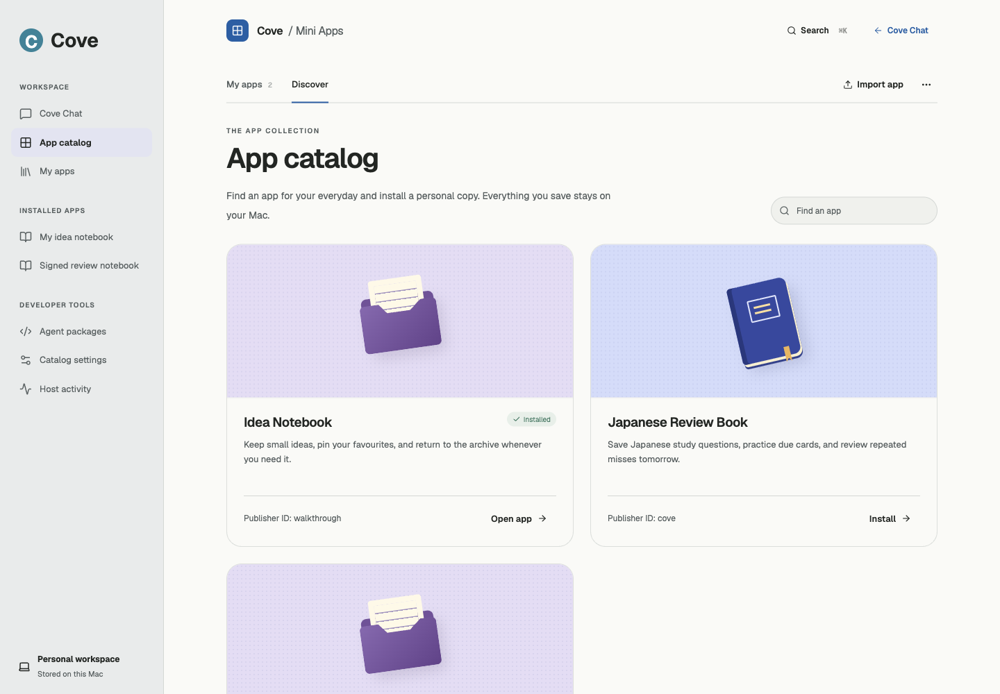
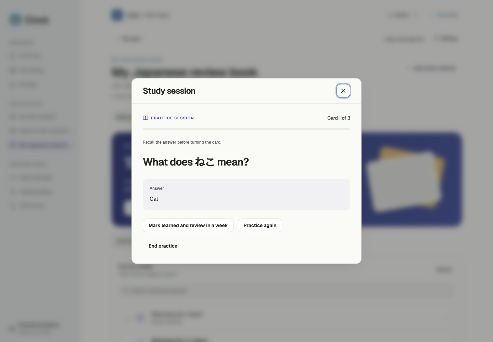
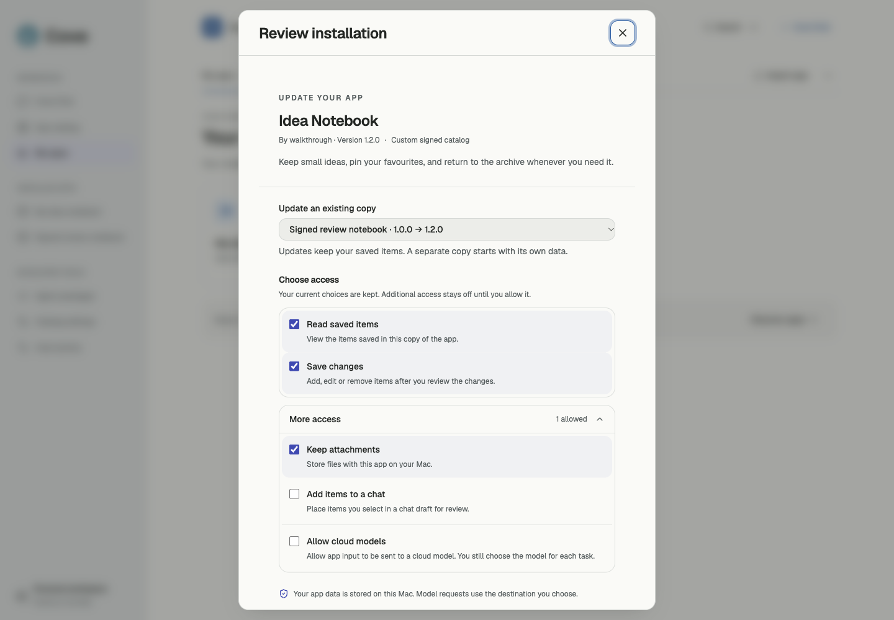
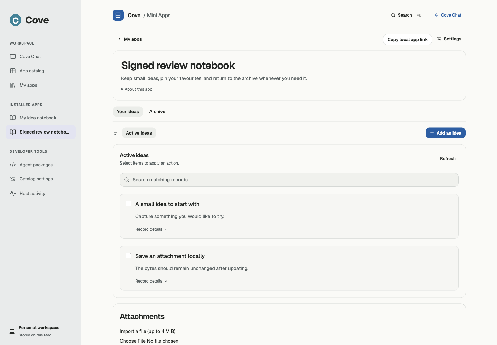

# Mini App acceptance

The local Mini App platform was reviewed against the design proposal, demo and
fourth-round review report. Runtime commit `58986ad` was packaged once; browser
acceptance used that immutable package with test commit `e1d392c`. Later changes
in this acceptance document and its screenshots do not change runtime behavior.

## Verified behavior

A browser-authored Idea Notebook was published through a local test publisher
using the repository's real catalog builder. The publisher retained immutable
releases and signed the catalog with Ed25519. The browser downloaded the exact
signed package bytes. The original integration walkthrough covered 1.0.0 to
1.1.0; the post-review run covered a signer-bound 1.0.0 copy updated manually to
1.2.0. Publishing and downloading alone did not update the installed copy.

All fourteen post-review checks passed: the instance and name were retained;
the version advanced; all three records, their IDs and original fields survived;
the migration added the archive field and advanced revisions once; attachments
and previous grants remained; new Chat access and cloud access stayed off; the
signer remained the same; and the earlier development copy was unchanged. The
attachment downloaded after the update matched its original bytes. The final
package was restarted against the same isolated data and both copies' exports
remained identical. The new Archive action was verified through its preview
and confirmation flow.

Japanese Review Book was also installed and used directly in the browser. A
three-card session revealed the answer to `What does ねこ mean?`, previewed a
learned outcome and saved it after confirmation. All three questions remained;
one became learned and two remained due. This run enabled only local record
reading and writing, with cloud access off.

## Checks

| Check | Result |
| --- | --- |
| `make check` | Passed: repository conventions, formatting, Go vet and TypeScript |
| Full Go `-race` suite | Passed |
| Web unit and interaction tests | 761 passed across 122 files; no unhandled errors |
| API contract tests | 138 passed |
| Script tests | 51 passed, 3 skipped |
| Apple Silicon package and Swift release build | Passed; local ad-hoc signing |
| Mini App browser acceptance | Passed: market, permissions, instances, upgrades, study, authoring and scrolling |
| App conversation and history acceptance | Passed: discovery, proposals, confirmed writes and Back/Stay/Leave/Forward |
| Existing Chat browser acceptance | Passed: comparison, context, retry/stop, PDF, history, export, Provider lifecycle, responsive layout and accessibility |
| Browser runtime exceptions in all three suites | Zero |
| Native `--os-handoff` | Passed: cold URL event restored the saved instance; system handler unchanged |
| Native compatible endpoint fixture | Passed: generated and saved two synthetic questions |
| Actual local signed-market walkthrough | Passed: create, publish, download, use, publish another version and confirm update |
| Independent public-contract authoring | Previously passed at `0e483c3`; not a new blind-author run in this pass |

Browser and native integration checks used disposable local data. Compatible
Provider fixtures verify transport and ownership; they do not measure model
quality or make paid inference requests. The local market service adds its
explicit test CA in an ignored test-only build overlay. The packaged production
service does not contain that overlay.

## Review fixes

- Releases persist their catalog signing authority. A different signer cannot
  update an existing copy. Custom directories and publisher IDs are labeled
  explicitly. Legacy key aliases preserve rollback checkpoints.
- Failed remote directory requests briefly reuse the bundled fallback. A slower
  failed request cannot overwrite a newer verified cache. Unchanged settings
  preserve default-directory tracking.
- Unsaved model results can be retried or explicitly discarded. Discard stores
  cancellation before releasing other App tasks and preserves saved data. Failed
  recovery remains visible, and Activity identifies the blocking app.
- Browser delivery shares one bounded retry policy. Debate attempts terminal
  cleanup independently of an aborted inference; an accepted verified answer
  cannot be replaced by that cleanup. Mini Apps retain their paid-result
  recovery behavior.
- Proposed non-default options are visible. Refreshed stale targets retire their
  write form with an explanation. Version selection replaces history, and an
  unavailable requested release is reported explicitly.
- First-party workspace Back/Forward protects drafts and active generation
  without replacing the target entry. Unknown legacy history uses the
  conservative fallback documented in ADR-0073.
- Native app-open failures are reported, and UTF-8 file selection includes JSON,
  YAML and HTML. Shared Chat selection and attachment behavior was regression
  tested.

## Compatibility and remaining acceptance

This branch uses database schema 32. Main-branch services with an older schema
reject that database. Earlier unreleased schema-32 development snapshots do not
implement signer binding and are not supported downgrade targets.

Old catalog instances without a recorded signer remain readable, but upgrades
fail closed. Their data is not deleted or automatically assigned a signer.
Exact-package `.covedata` restoration can recover data into a disabled copy that
requires new permissions. Ambiguous signing authorities are rejected. A
self-contained package-and-data transfer bundle is not implemented.

Production CoveWeb hosting and official signing configuration were outside this
local-market acceptance. Real `--managed` and HTTPS `--cloud` acceptance still
require the pinned model asset or dedicated test credentials. Physical Services
and `NSOpenPanel` interaction were not run in this pass. Full XCTest requires
Xcode rather than this machine's Command Line Tools; the Swift release build
and native acceptance harness did pass. Commands and prerequisites are in
[development.md](development.md#mini-app-native-acceptance-on-a-mac).

The report's additional product proposals, including personal author signatures,
publisher accounts, richer rule/field types, notifications, import, sync and
successful-upgrade rollback, remain roadmap decisions rather than completed v1
features. See [mini-apps.md](mini-apps.md), [mini-app-catalog.md](mini-app-catalog.md)
and [ADR-0073](adr/0073-host-declarative-mini-apps-on-the-mac.md) for the current
contract and boundaries.

## Browser screenshots

These are unaltered captures with synthetic local data. Catalog, practice and
restarted-copy images show the final runtime. Authoring, publishing and the update
review were captured during the integration walkthrough; their exact provenance
is retained in the local acceptance report.

### Catalog

### Japanese practice

### Manual update and preserved data

### Authoring and publishing

