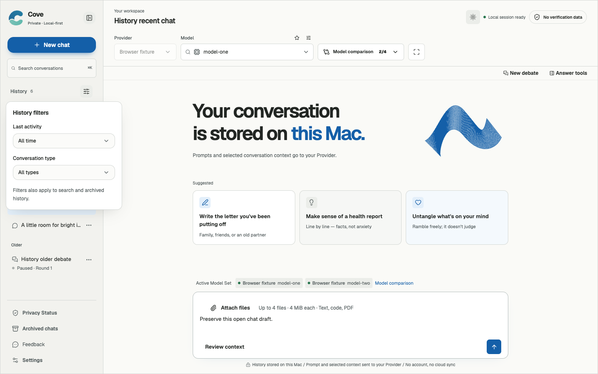
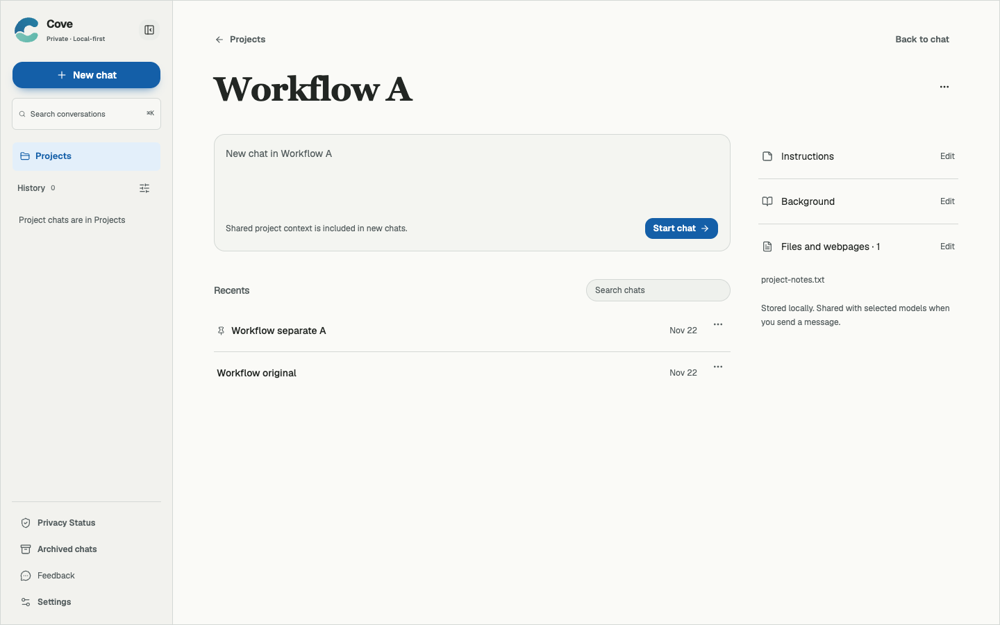
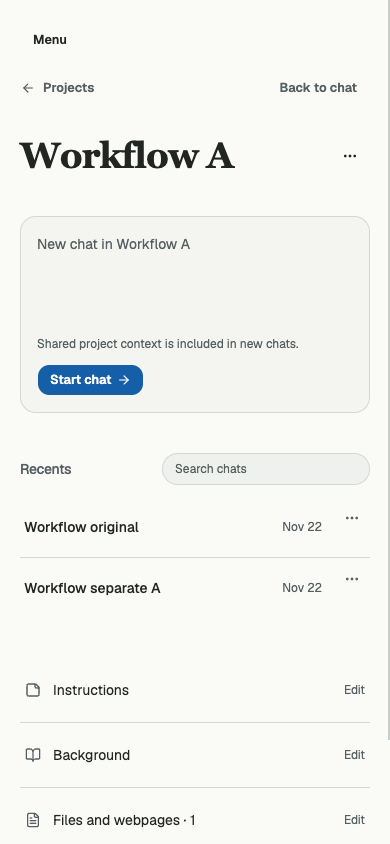

# Using Cove

For continuous multi-model discussions, see [Debate mode](debate.md).

Cove is a local-first AI chat application for Apple Silicon Macs running macOS 13 or later. Its menu-bar Launcher starts a Local Service and opens the Chat Surface in your browser or the Quick Panel. The interface is English. Messages, titles, and prompts support Unicode content.

This guide follows the current source tree, including unreleased features. See the [Beta 11 release notes](releases/0.1.0-beta.11.md) for the published package and the [unreleased changelog](../CHANGELOG.md#unreleased) for newer changes.

## Install and upgrade

Download [0.1.0-beta.11](https://github.com/tokenfunplus/cove/releases/tag/v0.1.0-beta.11), open the DMG, and drag Cove to Applications. A checksum file accompanies the download. Check the release page for Apple signing and notarization status.

For an upgrade, quit Cove from its menu-bar menu before replacing the app. Existing Cove history and settings remain in the local data directory. Provider Keys remain in macOS Keychain. Under Check for Updates, Check Stable Releases follows the stable channel; Check Beta Releases explicitly checks for newer betas, release candidates, or final versions. Builds before beta.4 can download beta updates from GitHub Releases.

The Launcher menu offers Open Quick Panel, Open Chat, New Chat, and Settings. When no Provider is configured, Set Up Provider opens Provider settings directly. Launcher Settings contains Launch at Login and the optional Quick Panel shortcut. macOS may require approval for a login item. Login launches stay in the menu bar without opening the browser. Manual launches and reopening Cove open Chat. If the Local Service fails, choose Retry and Open Chat.

Troubleshooting contains Restart Local Service, Open Data Folder, and Copy Diagnostics. The diagnostic summary excludes credentials, launch URLs, errors, and conversations. Check for Updates groups stable and explicit beta checks. After a newer release is found, the menu displays Update Available and keeps its download link available after dismissing the alert. About Cove contains the installed version/build and a Release Notes link for that exact version, including beta releases. Help & Feedback opens the user guide or issue tracker without submitting a report.

## Use the Quick Panel

Choose **Open Quick Panel** from the Cove menu bar. To open it from any app, enable **Launcher Settings > Quick Panel Shortcut: ⌃⌥C**, then press **Control-Option-C**. When Cove is ready, the panel opens with the composer focused so you can type immediately.

Type a question, paste text, or drop a supported file into the panel. Send your message and read the answer there. Use **Pin Quick Panel** to keep it above normal windows while you work. Press **Escape** or the shortcut again while the panel has focus to hide it. Hiding the panel keeps your unsent text and attachments in memory for the next time you open it. [Supported files and limits](#ask-about-files).

The panel grows as you add content. Drag an edge to choose your own size for the current Launcher session. Use **Tools** for additional composer actions and check the destination below the input before sending. New replies start below their question. Scroll up to keep your reading position during a reply, or choose **Jump to latest** to follow new text.

The first message starts a conversation in your local history. After the current response finishes, use **Continue in Cove** to open that conversation in your default browser. Unsent follow-up text and attachments stay in the panel. Choose **New chat** in the panel to start a separate task.

## Connect a Provider

Open **Settings → Provider settings**, choose a Provider, enter its API key, click **Test connection**, choose a model target for initial setup, then click **Save Provider**. A connection test alone does not save the key or profile. Provider Profiles describe connections; model targets belong to the Active Model Set. Setup initializes the chosen target only when no targets are selected. Saving Provider edits leaves an existing set unchanged; use the workspace's model controls to change its targets.

Custom Providers use OpenAI-compatible APIs and require HTTPS, except for loopback HTTP endpoints. The NearAI preset has a fixed staging endpoint; its availability and model catalog depend on that service.

See the [configuration reference](configuration.md#provider-profiles) for connection fields, generation parameter ranges and defaults, and local storage options.

macOS may request permission when Cove first reads an existing Provider Key or when its signing identity changes. Authorized keys are reused within the running Local Service. Catalog errors do not automatically retry on focus or reconnect. After granting access, use the explicit connection test to recover the catalog. Restart Cove after changing an existing key outside the running service.

## Install and use small local models

Open **Settings > On this Mac > Discover** to explore 31 small models across eleven uses, including retrieval, reranking, writing, code, translation, OCR, transcription, speech synthesis, audio preparation, image tools, and text classification. **Ready to use in Cove** separates integrated models from **Explore other models**, whose entries require separate integration. Choose a task, search text, or **Cove integration**; **Filters** adds language, file-size limits, and sorting by the smallest files first within each group. Explore-only results appear six at a time; **Show more models** reveals the next group. Switching between Installed and Discover preserves filters while Settings stays open. **Files and requirements** expands limitations, selected files, runtime, model license, publisher, conversion source, source revision, and external source links. Management and removal remain in Installed.

Use the 10 MB size limit to find tiny utilities such as language detection, portrait matting, or image classification. Larger limits expose Chinese OCR, bidirectional English/Chinese translation, Chinese speech synthesis, multilingual search, and additional small chat families. Sizes count the selected files rather than total installed memory or runtime disk space. See [catalog source notes](local-model-catalog.md).

Install **BGE Small Chinese v1.5** (about 26.5 MB), then open **Search local documents**. Add text, code, or text-based PDF files, select up to four documents, and enter a query. Open a result to inspect its original line or page sections. Choose the results to attach and click **Use selected results in chat**. Only these selected sections enter the submitted prompt; selecting a remote Provider sends them to that Provider. Similarity scores rank results and do not establish answer accuracy.

After validating retrieval, install **Qwen2.5 0.5B Instruct** (about 491 MB) and select its **On this Mac** target in the workspace model picker. It uses ordinary chat, streaming, history, and Stop controls without a Provider Key. These two models run offline after installation on Apple Silicon Macs with macOS 13.3 or later. The small chat model is experimental and can invent facts, omit citations, or produce incorrect code. Its suggested use is short rewriting and extraction from supplied material, with outputs checked against the original. Its context limit is 4,096 tokens and output limit is 1,024 tokens; oversized input fails. It cannot use Web Research tools.

For an alternative experimental chat target, install **Qwen3 0.6B Abliterated Q5_K_M** (444.4 MB) and choose **Use in this chat** on its own card. Both chat models can remain installed and selected independently. Qwen3 runs in non-thinking mode with the same context/output limits and offline controls. Its reduced refusals do not improve factual or coding accuracy. Installing or removing one model does not replace the other model's weights or saved answers. See [ADR-0054](adr/0054-add-qwen3-abliterated-local-chat.md).

Downloads show progress, support cancellation, and verify pinned file sizes and SHA-256 hashes before installation. Removing BGE deletes its vector indexes but keeps original library documents for reindexing. Deleting a library document removes its original, vectors, and pending result attachments; copies already saved in conversations remain. Clearing chat data also clears the library and keeps installed weights.

You can choose up to 32 files for a library import; each selected file is processed in order, subject to the 32-document library limit. Stop cancels the current request and prevents remaining files from starting. Closing the document dialog cancels pending work and prevents late search-source results from entering another chat draft. Search still covers only the one to four documents you select.

Five supported speech bundles can also be installed and used with Read aloud; see [local speech](local-speech.md). Unsupported catalog entries remain discovery-only. **View files** and **About this model** open external source websites. File sizes exclude runtimes and working memory. The discovery list itself works without a model-hub request. See [local inference acceptance](local-inference.md) for observed smoke-test results and their limits.

Hugging Face and publisher GitHub repositories provide the listed files. ModelScope is another hub to inspect individually; a matching name does not establish the same revision or artifact. Local tools can still supply results to a remote Provider when that Provider generates the final answer.

### Use local capabilities in a chat

Open **Tools > Search local documents** in the composer. If document search is not installed, download BGE in that dialog; your chat draft is retained. Select documents, search, inspect original passages, then choose **Copy selected text** or **Use selected results in chat**. The tool can run independently of the selected answer model. The execution line distinguishes **Search: On this Mac** from each answer destination.

**On this Mac** beside the model picker opens capability management. **Installed** shows downloaded tools and chat models; **Discover** includes additional candidates with their integration state. After downloading Qwen, **Use in this chat** explicitly selects its target without replacing the draft. Installing a model alone does not change your selection. OCR, transcription, unsupported speech candidates, and other explore-only entries still require integration.

Turn on **Only on this Mac** to restrict new chat and answer-tool submissions to managed local models. Web search is suppressed while the restriction is on without overwriting its saved per-conversation preference; external webpage preparation is blocked, and an incompatible model selection disables sending while preserving the draft. Choose a local model or turn off the restriction. The Local Service independently validates the restriction, including retries of older answers; saved local-only batches retain their restriction even after the window toggle is off. Explicit model downloads still require internet. Existing Debate sessions have separate rules and are not changed by this chat control.

### Choose how Project materials are used

The Project editor offers **Always include** and **Search when needed** for each material. Existing sources remain Always include. Instructions, background, and Always include sources go to each selected model as before. Search-only materials are excluded until you open **Tools > Search project materials**, select documents, and attach chosen passages. Indexing is performed locally when needed. A material has one use at a time, avoiding automatic inclusion of both its full text and retrieved passages. The three-material/60,000-character project limit remains in effect.

Changing use clears that material's vector index and pending retrieval selections; already saved chat snapshots remain unchanged. Removing BGE removes all search indexes, including Project indexes, while retaining originals. Clearing chat history also clears indexes and the global library, while retaining live Projects, Project materials, and installed model weights.

## Chat and compare models

Choose one model for an ordinary conversation, or up to four targets for a comparison. Each answer retains its Provider Snapshot and available verification evidence. Select the answer you want to include in the next turn's context, or continue without an answer from that turn.

A submitted turn captures its context. Retrying a target uses that same saved context and attached source input. Later changes to an earlier answer selection do not rewrite a turn already submitted.

Provider-supplied reasoning appears in a **Reasoning** section above the answer. It starts expanded while text is streaming and automatically collapses when streaming ends, including while a private response is being verified. Saved answers start collapsed. Click **Reasoning** to expand or collapse it manually. Structured reasoning is saved locally and included in exports, separately from the answer; later turns send only the selected answer body. Responses beginning with explicit `<think>`, `<reasoning>`, or `<analysis>` blocks also support folding, while retaining their original body and context. Previously saved prose without reasoning boundaries cannot be separated automatically.

Model selectors include locally bundled brand icons, model names and identifiers, and available Provider catalog details: input/output USD prices per million tokens, context/output limits, and capability labels. Search by model ID, name, publisher, or capability. Missing details remain unavailable. These are Provider-advertised capabilities; Cove currently sends text and extracted document text. Catalog prices are indicative and do not change your manually configured Generation cost estimates.

### Try interactive replies

Chat normally with one selected model. For eligible external models, Cove gives the model a compact optional UI format. Managed built-in local models and Providers advertising less than 8,192 context tokens receive no card guide. When a card fits the conversation, such as comparing a few plans or practicing a question, it may appear alongside the answer. Greetings, simple facts, and ordinary explanations should remain prose. There is no mode switch or template selection step. Whether a card appears depends on the selected model following these instructions.

Selecting options, revealing hints, and checking an answer do not call a Provider. Values save on this Mac. **Continue** sends the displayed selection and any question entered through **Ask about this**, using the current model and normal privacy requirements. Unrelated composer text and attachments remain unsent. **Expand** opens the same card with more space.

For an ordinary typed follow-up, the composer offers an unchecked **Include card** reference naming the latest eligible card. Current values save before Send or Review context, then travel with your question and any attached files. Check it when the question should use the card's current values; sending also saves and locks that card. Leave it unchecked for unrelated messages. A question can discuss unfinished choices or text; the card's primary Continue still validates required fields. Save failures preserve the draft and block sending. Discussion captures and locks the old card just like another conversation turn. This behavior also applies in the Quick Panel.

A submitted card becomes read-only. Retry reuses its saved interaction snapshot. Older or unselected answers cannot continue the current conversation. If another window changes a card, review the conflict and use **Reload and discard local changes** only when ready to replace your local choices. While a save is pending or has failed, keep the current window open until it is acknowledged.

Cards may also offer a draggable ranking with **Move up/down** buttons, labelled sliders with a live allocation total and remaining balance, or an editable text field alongside its immediate plain-text preview. Sliders support the arrow keys and plus/minus buttons. A negative balance explicitly shows the amount over budget; it does not silently change another value. **Undo** and **Redo** restore recent text edits in this window; **Reset** restores the card's starting values. These actions make no Provider request. Expand shares the current edits, and refresh restores acknowledged saves. Continue sends the current order, amounts, edited text, and registered allocation results to the selected model, then locks the submitted card.

Invalid or unsupported card output remains accessible through **View original JSON**. Matching and structured alternative-choice branches remain future work; ordinary conversation branching is available. Saved v1/v2 cards remain supported alongside v3 local-only cards. Pure reveal/recall cards can work without a Continue button. Wide-screen expansion opens a side panel; narrow screens use a dialog. During generation, UI payloads appear as a preparation status instead of scrolling JSON. Unsupported or incomplete cards keep the chat input usable, with readable fallback and optional original-source access. See [the original decision](adr/0063-add-json-interactive-chat-cards.md), [local editing extension](adr/0064-extend-interactive-cards-with-local-editing.md), and [visible follow-up context](adr/0065-include-visible-card-context-in-chat-followups.md), and [model input normalization](adr/0066-normalize-model-ui-and-bound-chat-overhead.md).

### Read mathematical notation

Assistant answers render inline math with `$...$` or `\(...\)`, and multiline display math with `$$...$$` or `\[...\]`. Long equations scroll horizontally inside the answer, including Model Comparison columns. Formula rendering and fonts work locally. Code, escaped delimiters, and ordinary currency stay literal; incomplete or unsupported formulas show readable source. Copying and exports retain the original LaTeX.

Prefer `\(...\)` when dollar signs are ambiguous with currency. Common notation includes fractions, Greek letters, vectors, matrices, and aligned equations. Formula rendering does not contact a Provider or a remote typesetting service.

### Faster model selection and reading

Use the star beside the Model label to favorite the current model. Favorites and recently selected models appear first. The filter button narrows the catalog by capability, minimum context, and maximum input/output USD price per million tokens. Missing Provider details do not pass the corresponding filter. The filter menus use the workspace theme. Escape closes an open option list before closing the filter panel. Clear filters to return to the full list. In Model comparison, name and save a combination to restore its entire model set with one click. Favorites, recent selections, and named combinations stay in this browser profile; storage restrictions can limit them to the current session.

Assistant headers show model identity and a short verification status. Open **Response details** for performance, Provider/Privacy information, and full verification reports. Verification problems remain visible before opening it.

Scrolling upward pauses following new responses. **Jump to latest** shows the number of answers updated while you were reading. Reasoning folds and stream layout changes preserve the current reading block where it remains available. Returning to the latest response or sending a new prompt resumes following.

### Follow up on a passage

Select up to 8,000 characters in a saved assistant answer to open **Explain**, **Give an example**, or **Ask about selection**. The action opens a side panel with a quoted passage and editable question; click **Send question** to contact your active models. **Ask about this** below an answer opens the same tool with its text (or an excerpt for longer answers).

The side question uses your active models, System Prompt, and generation settings. It starts a separate saved conversation with only the quoted passage, question, and source model identifier. It does not inherit or change the main conversation. Later questions use the separate side history; comparisons still need an answer selection or an explicit context skip before continuing. Side conversations remain available in local history. The main conversation and answer tools share Cove's one-active-Batch limit.

### Edit an answer in the workbench

Click **Edit in workbench** below a saved answer. Edit the copy directly, switch between **Edit**, **Preview**, and **Changes**, undo/redo, copy it, or download Markdown. The original answer, Provider context, and verification evidence remain unchanged.

Enter a **Revision request** to ask your active models to revise the draft. Select text in the editor to rewrite only that passage, or choose **Use whole draft**. The current draft and editing request are sent using your existing Provider transport. Review the proposed changes and click **Apply revision** to accept a model's result. A proposal cannot replace newer local edits made after its request.

Working drafts and up to 20 undo steps stay in this window's memory, including while the panel is closed. Download to retain a copy across reloads. Cove asks before replacing a changed draft and uses the browser's refresh/close protection where supported. Drafts are limited to 120,000 browser text units; supplementary Unicode characters count as two units. Revision requests and responses are saved as separate local conversations. Use **Answer tools** above the conversation to reopen the panel.

### Edit a prompt and branch

Click **Edit and resend** on a saved user message, edit the prompt, and choose which of your active models to run. **Send in new branch** creates a separate conversation with the saved context and exact attachments from that turn. It excludes the original answer and later messages; current System Prompt and generation settings apply. Earlier messages in the branch are independent copies, with verification evidence belonging to the original responses. The original conversation remains available. Sending or clearing your current unsent draft is required before editing another prompt.

### Wait and recover

During generation, Cove shows elapsed time and the current stage. A prolonged quiet period offers stopping the attempt. Failure controls can retry the original target, choose a model for a future submission, edit/resend in a branch, or open Provider settings. Selecting a different model does not alter the model used by an ordinary retry.

### Response performance

Open **Response details** below an answer to inspect total time, time to first text, input/output tokens, and output speed. Counts come from the Provider. Missing counts and older measurements are shown as unavailable. Private inference timings are measured in the browser and total time includes verification. Output speed uses the interval between first and last text chunks, so very short or buffered responses may have no useful speed measurement.

Optionally enter your Provider/model's input and output rates in USD per million tokens. Estimated cost uses those current rates and reported counts, excluding Provider-specific cache discounts and other charges. Rates stay in this browser; no pricing lookup or additional inference request is made.

### Focus and timeline bookmarks

Click the four-corner button beside Model comparison to enter Focus. It hides the sidebar, compacts the header and composer, and gives replies more room. Exit Focus or press Escape to restore the previous layout. Escape closes an open preview or dialog first. Drafts, attachments, model selections, and active responses are preserved. Command-K or Control-K leaves Focus and opens conversation search.

In Focus, open the **Tools** icon for **Attach files**, **Read webpage**, **Review context**, and local document search. The execution line and **Only on this Mac** control remain visible; focus or hover over the execution line for the processing notice.

The slim timeline on the right has one marker per user turn; the longer, darker marker follows your reading position. Hover or keyboard-focus a marker to preview its prompt and a short answer excerpt. Move into the card to save or remove a bookmark, or click a marker to jump to that turn. The card stays open while moving between the marker and its controls. On touch screens, tap a marker to open its preview and navigate.

Bookmarks save conversation/message identifiers only in this browser profile for the Local Service address. They survive reloads but are not included in database backups or conversation exports. Clearing browser data removes them. If storage is unavailable, the card reports that changes last for the current session only. Previewing and bookmarking do not contact a Provider or change later conversation context.

## Filter history

Use the filter button beside **History** below the sidebar search field. **Last activity** offers All time, Today, Last 7 days, and Last 30 days; **Conversation type** offers All types, Chat, and Debate. Dates follow your local timezone and include today. Filters combine with search and the archive view. The toolbar shows the matching count and removable filter chips; **Reset filters** returns to the full list. Filtering preserves the conversation and draft already open.

Only the two filter choices are remembered in this browser profile for the Local Service address. Search phrases and conversation content are not stored with those preferences. Activity uses the conversation's existing update time, including completed model responses and Debate updates.

Debates show Running, Pausing, Paused, or Stopped and their current round. State labels reconcile with the Local Service while the page is open. Reading or filtering history does not start Provider work. Debate body search remains limited to its title; ordinary Chat search also matches locally saved user/assistant text.

## Read webpages

Click **Read webpage** beside the attachment button. A URL already present in your message is offered in the dialog; you can also enter a public HTTP or HTTPS URL. Click **Read webpage** to contact that website and extract its readable text. Preview the source, enter your question, and send. The preview shows the final URL and read time. Answer citations open the saved source lines, with an option to open the original website.

Webpages and files share the four-source count and character limits below. A webpage response is limited to 4 MiB and fifteen seconds. Previews expire after fifteen minutes; remove an expired source and read it again. Removing a loading source cancels its request. Sources stay with your unsent draft and are discarded on confirmed navigation or reload.

The reader supports HTML and plain text available from a public URL. Pages requiring JavaScript, authentication, or access through a private network can fail. Failure details appear on the source card. Extracted text is sent to the selected Providers when you send the question. Original page bytes, source URLs, and text are saved locally with that turn, and retries and edited branches reuse that saved version. Markdown/JSON exports include the extracted text and webpage provenance.

## Ask about files

Attach supported files in the composer, preview the extracted text, and inspect the draft Provider context before sending. Previews are local and do not contact a Provider or save a draft. Navigating away or reloading discards draft attachments.

| Limit | Supported value |
| --- | --- |
| Files per turn | Up to 4 |
| Original file size | Up to 4 MiB per file |
| Formats | UTF-8 text, Markdown, code, and text-based PDF |
| Extracted text | Up to 60,000 Unicode characters per file and 120,000 across attachments |
| Text lines | Up to 4,000 per text file |
| PDF pages | Up to 50 |
| Total application input | Up to 240,000 Unicode characters, including System Prompt and selected history |

Empty, binary, password-protected, scanned-only, unsupported, and oversized inputs are rejected. Run OCR outside Cove for scanned PDFs. These application limits are not token counts; a model can have a smaller context window.

On submission, Cove saves the original bytes and an immutable extracted-text snapshot with the turn. Providers receive extracted text through the selected transport. Comparisons, retries, and later selected context use the saved snapshot even if the original file changes on disk.

Open an answer's source citations to navigate saved lines or pages. Citations are navigation aids, not independent proof that a model's claim is correct. Original files can be downloaded from the saved source view. Conversation exports contain source text and metadata, but not original file bytes.

## Recover a model download

If a local chat, document search, or speech model cannot reach its source, choose **Network settings…** on the failed download, or open **Settings > Network**.

1. Use **System proxy** to follow macOS network settings, or choose **Manual proxy** and paste the HTTP or SOCKS5 address shown by your proxy app, including its port. Keep that app running. Proxy usernames and passwords are not supported.
2. Choose **Test connection**. Cove checks Hugging Face and GitHub using the current values without saving them or downloading a model.
3. Choose **Save settings**, return to **On this Mac**, and retry the download. Retry resumes a retained partial file when supported, then checks the complete file before installation.

**Direct connection** bypasses proxies for these downloads. Changes apply to the next download or retry without restarting Cove. See [download connection details](configuration.md#model-download-connections) for scope and storage.

## Appearance and local data

Settings offers Continuum, Blueprint, Studio, and Grove workspace skins, with Light, Dark, and System appearance. Skin choice is saved in the browser for the Local Service address.

Search, pin, archive, rename, or export conversations from the workspace. History, settings, and attachments are stored under `~/Library/Application Support/cove/` in SQLite; Provider Keys use Keychain. Cove does not encrypt its local database or exports. Quit Cove before backing up its data directory, and protect backups like the original data. A database backup does not include Keychain credentials.

Search matches titles and saved user/assistant text, including Unicode content, within the current active or archived list. Message matches show a short excerpt; selecting one opens its originating turn. Up to 50 conversations are returned per search, so refine broad queries. Search stays on your Mac and does not send content to a Provider.

Updated builds index saved message text locally; the first launch after upgrading builds that index for existing history. For larger histories, use at least three characters to benefit from indexed phrase matching. Shorter queries remain supported through a local scan.

Switching conversations, changing the archive filter, or starting a new chat asks before discarding unsent text or attachments, including files whose preview is still loading. Stay keeps the current draft; Discard and continue completes navigation. Browser navigation also requests confirmation for an unsent draft where supported. Drafts are held in memory rather than saved to browser storage.

Markdown exports group comparison answers with their user turn and identify the Selected Answer, an explicitly context-skipped turn, or an unresolved comparison. Labels describe saved state at export time; they do not change the immutable Context Snapshots of already submitted turns. Other completed answers and saved source snapshots remain included.

Deleting a conversation or clearing history removes its saved attachment records. It does not delete exported files, backups, or copies retained by a Provider. See the [privacy model](privacy.md) for storage, network destinations, and verification limits.

## Get help

Start with the [FAQ and troubleshooting guide](faq.md) for installation, Keychain access, unavailable models, and Local Service recovery.

Read the [beta release notes](releases/0.1.0-beta.11.md), use [GitHub Issues](https://github.com/tokenfunplus/cove/issues) for reproducible problems, or join the [Cove Discord community](https://discord.gg/7jdddhG8ZG) for setup discussion. Include the app and macOS versions in bug reports, and remove credentials, launch URLs, and private content from diagnostics.

## Let a model search the web

Click the globe beside Send to turn Web search on or off for the current conversation. New conversations start off. If no default search key is configured, Cove opens Settings → Web search and preserves your draft. Choose Tavily, Linkup, or Exa, enter a key, and use **Test and save**. Key testing makes one search request. The current conversation enables Web search after successful setup; close Settings and send your question.

With the toggle on, models can search, read public HTML pages, or answer directly. Each model attempt defaults to three search requests, five page reads, five results per search, eight total tool calls, and a ninety-second web phase. Settings groups the search connection and per-model request limits separately. Expand **Advanced settings** for search depth, result counts, tool limits, timeout, and domain filters. Four comparison models can use up to twelve searches with defaults. Failed requests count, cached results do not; request limits do not represent a billing-credit cap. Retries start independent budgets. Stop cancels active web requests. The existing overall Generation timeout still applies.

Answers link to saved source sections and list resolvable citations under **References**. Click a title for the saved excerpt or page; **Original** opens the source website. **Web research** shows queries, page reads, cache hits, errors, and usage when the search service reports it. Search excerpts are labelled separately from retrieved pages. If no tools were used, the answer says Web search was available and unused. Sources are retained with history, retries, branches, and local exports.

Web search requires native tool calling support from the chosen model. A rejected or incompatible tool request fails visibly; turn the toggle off or choose another model. Cove does not silently switch search Providers. Search queries go to the selected search service outside NearAI encrypted inference. Dynamic JavaScript rendering, signed-in pages, and private network addresses are not supported. Continuous Debate and answer-tool side conversations do not inherit the main chat toggle. The composer toolbar uses icons for **Attach files**, **Read webpage**, and **Review context**; hover or focus an icon for its label. Manual **Read webpage** remains available through the link icon.

## Reuse project background

Open **Projects** in the sidebar and choose **New project** to save a name, Project Instructions and Project Background. Instructions guide the model; background is reference data. Save changes before adding fixed files or public webpages. The editor previews extracted source sections. Each Project supports three materials with 60,000 extracted characters in total, leaving capacity for at least one new turn source under the existing attachment limits.

Use a conversation menu's **Move to project** action to move an existing Conversation. Global **New chat** creates an ungrouped conversation; **Start chat** in a project home creates one in that project. Sidebar History and its search show only ungrouped chats. Moving preserves existing history, including anything previously stated about another Project; it changes project input for new turns only. Branches inherit their source conversation's current Project. Side conversations derive membership from the conversation containing the quoted answer. Debate history supports grouping, while Debate model inputs continue using its existing rules.

The composer shows a collapsed context summary for assigned chats; expand it for remaining source capacity. **Review context** and **Review project context** show exact input and character counts for instructions, background, sources, history and the current question. Project content goes to every selected model on each turn. A project edit racing submission preserves the draft and refreshes project information; review and send again. If the complete context exceeds 240,000 characters, use **Continue in a new conversation** to carry the draft and attachments into a fresh chat in the same Project without sending automatically.

A saved turn keeps its original project snapshot for retries, source citations, downloads and exports. Changing background or removing a fixed source affects future turns; historical copies remain. **Dissolve and keep conversations** moves current members to Ungrouped. **Delete project and its conversations** deletes current members after stopping their work. Both confirmations explain historical copies that remain in other Conversations. Clearing chat history preserves live Project settings and materials, while clearing their vector indexes.

### Project navigation

The sidebar History and conversation search show ungrouped chats. Open Projects to find project chats, including archived chats. Conversation actions are available from each project chat row and from the project breadcrumb toolbar while reading a project chat. Moving a chat back to No project makes it appear in ordinary History again. The current destination cannot be submitted as a move. If membership changed elsewhere, use **Refresh current project**, review its current location, then choose and submit a destination again.

Use the project card or project home’s **⋯** menu to edit, dissolve, or delete a project. **Dissolve project** keeps its conversations and moves them to Ungrouped; **Delete project** permanently removes its current conversations after confirmation. Historical snapshots in surviving conversations remain available.

The project home has a draft entry above its recent chats and compact controls for instructions, background, and files or webpages. **Start chat** carries the typed question into a new project chat; review model choices and use Send there. Project-home drafts stay in this window when you browse between projects.

### Read answers aloud

In Settings > On this Mac > Discover, filter by Speak text and install a voice model. Open the Speech tab to choose English/Chinese defaults, voices, speed, volume, and available model options. Click the sound icon below an answer to read it locally. Pause, resume, stop, and WAV export are available in the player. If a model is missing, Cove links to Discover and keeps your draft. See [Local speech](local-speech.md).
