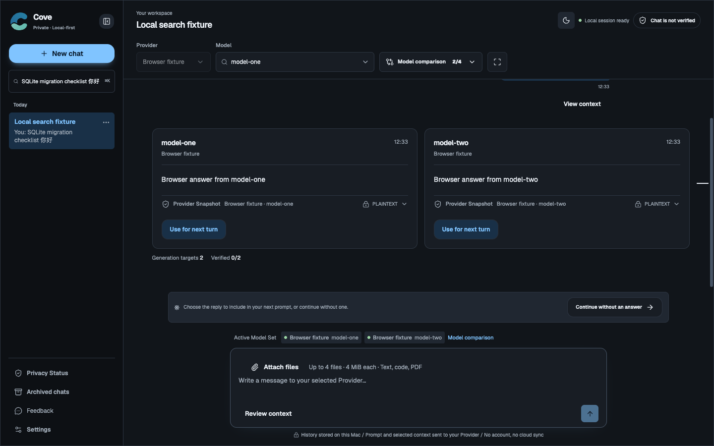

# Using Cove

Cove is a local-first AI chat application for Apple Silicon Macs running macOS 13 or later. Its menu-bar Launcher starts a Local Service and opens the Chat Surface in your browser. The interface is English; messages, titles, and prompts support Unicode content.

## Install and upgrade

Download [0.1.0-beta.3](https://github.com/tokenfunplus/cove/releases/tag/v0.1.0-beta.3), open the DMG, and drag Cove to Applications. Published beta packages are Developer ID signed and Apple notarized. A checksum file accompanies each download.

For an upgrade, quit Cove from its menu-bar menu before replacing the app. Existing Cove history and settings remain in the local data directory. Provider Keys remain in macOS Keychain. Check for Updates follows the stable channel; updated builds also offer an explicit Check for Beta Updates action. Older builds can download beta updates from GitHub Releases.

The Launcher menu offers Open Chat, New Chat, and Settings. Launch at Login and the global Control-Option-Space shortcut are optional; macOS may require approval for a login item. Troubleshooting contains Restart Local Service, Open Data Folder, and Copy Diagnostics. The diagnostic summary excludes credentials, launch URLs, errors, and conversations. Click the full version number to read that exact version's GitHub Release notes, including beta releases. Help & Feedback opens the user guide or issue tracker without submitting a report.

## Connect a Provider

Open **Settings → Provider settings**, choose a Provider, enter its API key, click **Test connection**, choose a model target for initial setup, then click **Save Provider**. A connection test alone does not save the key or profile. Provider Profiles describe connections; model targets belong to the Active Model Set. Setup initializes the chosen target only when no targets are selected. Saving Provider edits leaves an existing set unchanged; use the workspace's model controls to change its targets.

Custom Providers use OpenAI-compatible APIs and require HTTPS, except for loopback HTTP endpoints. The NearAI preset has a fixed staging endpoint; its availability and model catalog depend on that service.

See the [configuration reference](configuration.md#provider-profiles) for connection fields, generation parameter ranges and defaults, and local storage options.

macOS may request permission when Cove first reads an existing Provider Key or when its signing identity changes. Authorized keys are reused within the running Local Service. Catalog errors do not automatically retry on focus or reconnect. After granting access, use the explicit connection test to recover the catalog. Restart Cove after changing an existing key outside the running service.

## Chat and compare models

Choose one model for an ordinary conversation, or up to four targets for a comparison. Each answer retains its Provider Snapshot and available verification evidence. Select the answer you want to include in the next turn's context, or continue without an answer from that turn.

A submitted turn captures its context. Retrying a target uses that same saved context and attached source input. Later changes to an earlier answer selection do not rewrite a turn already submitted.

### Focus and timeline bookmarks

Click the four-corner button beside Model comparison to enter Focus. It hides the sidebar, compacts the header and composer, and gives replies more room. Exit Focus or press Escape to restore the previous layout. Escape closes an open preview or dialog first. Drafts, attachments, model selections, and active responses are preserved. Command-K or Control-K leaves Focus and opens conversation search.

The slim timeline on the right has one marker per user turn; the longer, darker marker follows your reading position. Hover or keyboard-focus a marker to preview its prompt and a short answer excerpt. Move into the card to save or remove a bookmark, or click a marker to jump to that turn. The card stays open while moving between the marker and its controls. On touch screens, tap a marker to open its preview and navigate.

Bookmarks save conversation/message identifiers only in this browser profile for the Local Service address. They survive reloads but are not included in database backups or conversation exports. Clearing browser data removes them. If storage is unavailable, the card reports that changes last for the current session only. Previewing and bookmarking do not contact a Provider or change later conversation context.

## Ask about files

Attach supported files in the composer, preview the extracted text, and inspect the draft Provider context before sending. Previews are local and do not contact a Provider or save a draft. Navigating away or reloading discards draft attachments.

| Limit | Supported value |
| --- | --- |
| Files per turn | Up to 4 |
| Original file size | Up to 4 MiB per file |
| Formats | UTF-8 text, Markdown, code, and text-based PDF |
| Extracted text | Up to 60,000 Unicode characters per file and 120,000 across attachments |
| Text lines | Up to 4,000 per text file |
| PDF pages | Up to 50 |
| Total application input | Up to 240,000 Unicode characters, including System Prompt and selected history |

Empty, binary, password-protected, scanned-only, unsupported, and oversized inputs are rejected. Run OCR outside Cove for scanned PDFs. These application limits are not token counts; a model can have a smaller context window.

On submission, Cove saves the original bytes and an immutable extracted-text snapshot with the turn. Providers receive extracted text through the selected transport. Comparisons, retries, and later selected context use the saved snapshot even if the original file changes on disk.

Open an answer's source citations to navigate saved lines or pages. Citations are navigation aids, not independent proof that a model's claim is correct. Original files can be downloaded from the saved source view. Conversation exports contain source text and metadata, but not original file bytes.

## Appearance and local data

Settings offers Continuum, Blueprint, Studio, and Grove workspace skins, with Light, Dark, and System appearance. Skin choice is saved in the browser for the Local Service address.

Search, pin, archive, rename, or export conversations from the workspace. History, settings, and attachments are stored under `~/Library/Application Support/cove/` in SQLite; Provider Keys use Keychain. Cove does not encrypt its local database or exports. Quit Cove before backing up its data directory, and protect backups like the original data. A database backup does not include Keychain credentials.

Search matches titles and saved user/assistant text, including Unicode content, within the current active or archived list. Message matches show a short excerpt; selecting one opens its originating turn. Up to 50 conversations are returned per search, so refine broad queries. Search stays on your Mac and does not send content to a Provider.

Switching conversations, changing the archive filter, or starting a new chat asks before discarding unsent text or attachments, including files whose preview is still loading. Stay keeps the current draft; Discard and continue completes navigation. Browser navigation also requests confirmation for an unsent draft where supported. Drafts are held in memory rather than saved to browser storage.

Markdown exports group comparison answers with their user turn and identify the Selected Answer, an explicitly context-skipped turn, or an unresolved comparison. Labels describe saved state at export time; they do not change the immutable Context Snapshots of already submitted turns. Other completed answers and saved source snapshots remain included.

Deleting a conversation or clearing history removes its saved attachment records. It does not delete exported files, backups, or copies retained by a Provider. See the [privacy model](privacy.md) for storage, network destinations, and verification limits.

## Get help

Start with the [FAQ and troubleshooting guide](faq.md) for installation, Keychain access, unavailable models, and Local Service recovery.

Read the [beta release notes](releases/0.1.0-beta.3.md), use [GitHub Issues](https://github.com/tokenfunplus/cove/issues) for reproducible problems, or join the [Cove Discord community](https://discord.gg/7jdddhG8ZG) for setup discussion. Include the app and macOS versions in bug reports, and remove credentials, launch URLs, and private content from diagnostics.
